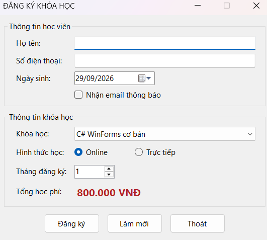
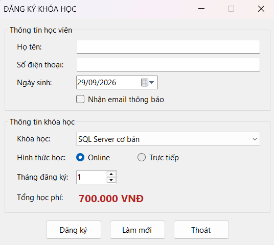
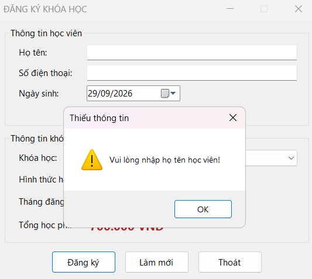
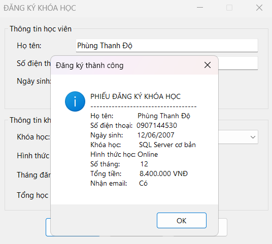

## Thông tin sinh viên
- Họ tên: Phùng Đăng Khoa
- MSSV: 51.01.104.046
- Lớp: 51.01.CNTT.A

## Mô tả
CourseRegistrationApp là ứng dụng Windows Forms cơ bản bằng C# nhằm quản lý việc đăng ký khóa học[cite: 3]. Ứng dụng tập trung vào việc thiết kế giao diện bằng Form Designer, sử dụng các control chuẩn (TextBox, ComboBox, RadioButton, DateTimePicker, NumericUpDown...) và xử lý các sự kiện cơ bản như `Click`, `Load`, `SelectedIndexChanged`, `ValueChanged`[cite: 3]. Chương trình cũng thực hiện kiểm tra ràng buộc dữ liệu đầu vào và hiển thị kết quả qua `MessageBox`[cite: 3].

## Chức năng
Chương trình bao gồm các tính năng chính sau:
1. **Khởi tạo dữ liệu (Form Load)**: Nạp danh sách 4 khóa học vào ComboBox (C# WinForms cơ bản, SQL Server cơ bản, Web Frontend cơ bản, Lập trình Python cơ bản), chọn mặc định khóa học đầu tiên, hình thức Online và số tháng là 1 (tối đa 12)[cite: 3].
2. **Tính tổng học phí tự động**: Tự động cập nhật tổng học phí ngay khi người dùng thay đổi khóa học (SelectedIndexChanged) hoặc thay đổi số tháng (ValueChanged)[cite: 3]. Tổng tiền = học phí 1 tháng $\times$ số tháng[cite: 3].
3. **Đăng ký**: Kiểm tra họ tên và số điện thoại không được rỗng[cite: 3]. Nếu hợp lệ, hiển thị phiếu đăng ký qua MessageBox chứa đầy đủ thông tin: họ tên, số điện thoại, ngày sinh, khóa học, hình thức học, số tháng, tổng tiền và trạng thái nhận email[cite: 3].
4. **Làm mới (Reset)**: Xóa họ tên và số điện thoại, đưa ngày sinh về ngày hiện tại, bỏ chọn nhận email, chọn lại khóa học đầu tiên, chọn lại hình thức Online, đưa số tháng về 1 và đưa con trỏ về ô họ tên[cite: 3].
5. **Thoát**: Hiển thị hộp thoại xác nhận trước khi thoát, chỉ đóng Form nếu người dùng chọn Yes[cite: 3].

## Cấu trúc Giao diện (Controls)
Giao diện được chia thành 2 GroupBox[cite: 3]:
- **Thông tin học viên**: `txtHoTen` (Họ tên), `txtSoDienThoai` (Số điện thoại), `dtpNgaySinh` (Ngày sinh), `chkNhanEmail` (Nhận email thông báo)[cite: 3].
- **Thông tin khóa học**: `cboKhoaHoc` (Chọn khóa học), `radOnline` / `radOffline` (Hình thức học), `numSoThang` (Số tháng đăng ký), `lblTongTien` (Hiển thị tổng học phí)[cite: 3].
- **Vùng nút lệnh**: `btnDangKy`, `btnLamMoi`, `btnThoat`[cite: 3].

## Cách chạy
- Mở file `.sln` của project CourseRegistrationApp bằng Visual Studio.
- Nhấn `F5` (hoặc nút Start) để build và chạy ứng dụng.
- Tương tác với giao diện trên cửa sổ Windows Form.

## Hình ảnh mô tả chức năng và lỗi

**0. Giao diện**

**1. Cập nhật giá tiền theo khóa học**

**2. Ràng buộc dữ liệu**

**3. Đăng ký thành công**

