# BÁO CÁO LAB 11: ADO.NET VÀ CRUD VỚI SQL SERVER

- **Học phần:** COMP1019 - Lập trình trên Windows
- **Giảng viên hướng dẫn:** ThS. Lê Thanh Thoại
- **Sinh viên thực hiện:** Phùng Đăng Khoa - 51.01.104.046
- **Công cụ:** Visual Studio, .NET 8, C# Windows Forms, thư viện `Microsoft.Data.SqlClient` 5.2.2
- **Cơ sở dữ liệu:** Microsoft SQL Server Express (`localhost\SQLEXPRESS01`), quản trị bằng SSMS
- **Đề tài:** Form quản lý lớp học (bảng `LOP`) kết nối trực tiếp SQL Server, không lưu tạm bằng `List<T>`

---

## 1. Cấu trúc tệp nộp bài

```
COMP1019_Buoi11_Lab11
|-- COMP1019_Buoi11_Lab11.sln
|-- EduManagerDB.sql                : script tạo database tối thiểu + dữ liệu mẫu (an toàn khi chạy lại)
|-- TESTCASES.md                    : danh sách test case tự kiểm thử
|-- images/                         : 13 ảnh chụp minh chứng
|-- README.md                       : báo cáo này
`-- COMP1019_Buoi11_Lab11/
    |-- Program.cs
    |-- DbConfig.cs                 : chuỗi kết nối (nơi duy nhất cần sửa)
    |-- FrmLop.cs                   : xử lý sự kiện + truy cập dữ liệu ADO.NET
    `-- FrmLop.Designer.cs          : giao diện, tên control theo đề
```

---

## 2. Cơ sở dữ liệu sử dụng

Chương trình dùng database **EduManagerDB** đã tạo ở Lab 10, với hai bảng chính:

| Bảng | Cột chính | Ghi chú |
| :--- | :--- | :--- |
| `LOP` | `MaLop` (PK, `VARCHAR(10)` ở Lab 10), `TenLop` (`NVARCHAR(100)`), `MaKhoa` (FK → `KHOA`) | Bảng được quản lý trên Form |
| `SINHVIEN` | `MaSV` (PK), `HoTen`, `MaLop` (FK → `LOP`) | Dùng để kiểm tra lớp đang có sinh viên khi xóa |

Khóa ngoại `SINHVIEN.MaLop → LOP.MaLop` làm SQL Server không cho xóa lớp đang có sinh viên; chương trình kiểm tra trước để báo lỗi dễ hiểu và vẫn bắt lỗi khóa ngoại (mã lỗi 547) phòng trường hợp phát sinh dữ liệu sau lúc kiểm tra.

**Lưu ý về cột `MaKhoa`:** bảng `LOP` của Lab 10 có thêm cột `MaKhoa` bắt buộc, trong khi script tối thiểu của đề Lab 11 chỉ có `MaLop` và `TenLop`. Chương trình tự nhận biết điều này khi mở Form (hàm `DetectSchema` kiểm tra `sys.columns`):

- Có cột `MaKhoa` (database Lab 10): Form hiện thêm ô chọn **Khoa** và cột **Mã khoa** trong lưới; thêm/sửa lớp sẽ ghi cả khoa.
- Không có cột `MaKhoa` (script tối thiểu của đề): các control này được ẩn, Form chạy đúng như yêu cầu của đề.

Dữ liệu mẫu từ Lab 10: 5 lớp (CNTT01 có 3 sinh viên, CNTT02 có 2, CNTT03 có 0, SPTIN01 có 2, SPTIN02 có 1).

---

## 3. Connection string đang sử dụng trên máy cá nhân

Chuỗi kết nối nằm ở **một chỗ duy nhất**: file `DbConfig.cs`, hằng `DefaultConnectionString` (dòng 9-10).

```
Data Source=localhost\SQLEXPRESS01;Initial Catalog=EduManagerDB;Integrated Security=True;TrustServerCertificate=True
```

| Thành phần | Ý nghĩa |
| :--- | :--- |
| `Data Source=localhost\SQLEXPRESS01` | Tên server: SQL Server Express (instance `SQLEXPRESS01`) cài trên máy này, đúng với tên hiển thị trong SSMS |
| `Initial Catalog=EduManagerDB` | Database sử dụng |
| `Integrated Security=True` | Đăng nhập bằng tài khoản Windows, không cần lưu mật khẩu trong code |
| `TrustServerCertificate=True` | `Microsoft.Data.SqlClient` mặc định bắt buộc mã hóa kết nối, còn SQL Server cài trên máy cá nhân dùng chứng chỉ tự ký nên cần tin cậy chứng chỉ này |

Nếu chạy trên máy khác, chỉ cần đổi `Data Source`: `.` hoặc `localhost` (SQL Server mặc định), `.\SQLEXPRESS` (Express), `(localdb)\MSSQLLocalDB` (LocalDB). Cũng có thể không sửa code mà đặt biến môi trường `EDUMANAGER_CONNSTR` bằng chuỗi kết nối đầy đủ.

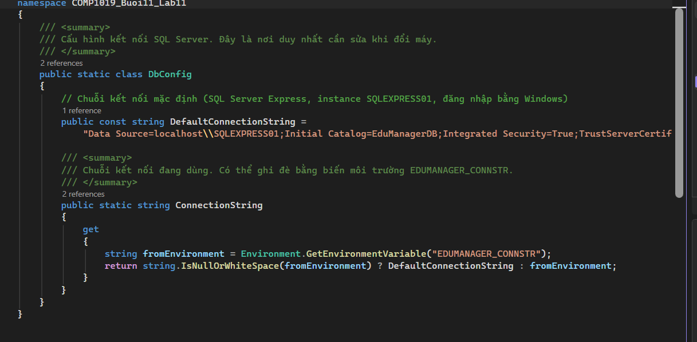

---

## 4. Thiết kế giao diện

Form chính `FrmLop` (tiêu đề "Quản lý lớp học - EduManagerDB"), đặt tên control đúng theo đề:

| Control | Tên | Chức năng |
| :--- | :--- | :--- |
| Label, TextBox | `lblMaLop`, `txtMaLop` | Nhập / hiển thị mã lớp |
| Label, TextBox | `lblTenLop`, `txtTenLop` | Nhập / hiển thị tên lớp |
| Label, ComboBox | `lblKhoa`, `cboKhoa` | Chọn khoa (chỉ hiện khi bảng `LOP` có cột `MaKhoa`) |
| TextBox | `txtTimKiem` | Nhập từ khóa tìm theo mã hoặc tên lớp |
| DataGridView | `dgvLop` | Hiển thị danh sách lớp (kèm cột "Số sinh viên") |
| Button | `btnThem`, `btnSua`, `btnXoa` | Thêm, sửa, xóa lớp |
| Button | `btnLamMoi`, `btnTimKiem` | Làm mới, tìm kiếm |
| StatusStrip | `lblStatus`, `lblCount` | Thông báo thao tác vừa thực hiện và số lớp đang hiển thị |

---

## 5. Các chức năng đã thực hiện

| Mã | Chức năng | Cách thực hiện |
| :--- | :--- | :--- |
| F1 | Tự load danh sách lớp khi mở Form | `FrmLop_Load` gọi `LoadData`, dùng `SqlDataAdapter.Fill` đổ vào `DataTable` rồi gán cho `dgvLop.DataSource` |
| F2 | Chọn dòng đưa dữ liệu lên ô nhập | Sự kiện `dgvLop_SelectionChanged` (dùng được cả chuột và phím mũi tên) và `dgvLop_CellClick`; mã lớp bị khóa vì là khóa chính |
| F3 | Thêm lớp | Không cho để trống mã/tên, không cho trùng mã (`IsMaLopExists`, thêm bắt lỗi 2627/2601 của SQL Server); mã lớp chỉ nhận chữ không dấu, số, `_`, `-` |
| F4 | Sửa lớp | Chỉ sửa tên lớp (và khoa) theo mã đang chọn; chưa chọn lớp thì báo lỗi |
| F5 | Xóa lớp | Không cho xóa lớp đang có sinh viên (`CountSinhVienByLop`); hỏi xác nhận bằng `MessageBox`; bắt thêm lỗi khóa ngoại 547 |
| F6 | Tìm kiếm | `LIKE @kw` trên mã hoặc tên lớp, không phân biệt hoa/thường; nhấn Enter cũng tìm; các ký tự đặc biệt của LIKE (`%`, `_`, `[`) được xử lý như chữ thường |
| F7 | Làm mới | Xóa các ô nhập và ô tìm kiếm, mở khóa mã lớp, tải lại dữ liệu |
| F8 | Tham số hóa câu SQL | Mọi câu SQL có dữ liệu người dùng đều dùng `SqlParameter` có kiểu rõ ràng (`VarChar(20)`, `NVarChar(100)`), không nối chuỗi dữ liệu người dùng vào câu lệnh |

**Xử lý lỗi:** mọi thao tác database nằm trong `try/catch (SqlException)`. Lỗi kết nối, đăng nhập, thiếu bảng được dịch ra gợi ý dễ hiểu (hàm `ShowDbError`); lỗi trùng khóa (2627, 2601) và khóa ngoại (547) có thông báo riêng. Kết nối luôn được đóng bằng `using`.

---

## 6. Ảnh chụp minh chứng thực nghiệm

### 6.1. Kết nối và load dữ liệu (F1)

Khi mở Form, chương trình tự kết nối `EduManagerDB` và hiển thị danh sách lớp lên `dgvLop`. Lưới có 5 lớp kèm số sinh viên của từng lớp, thanh trạng thái báo "Đã tải danh sách lớp từ SQL Server".

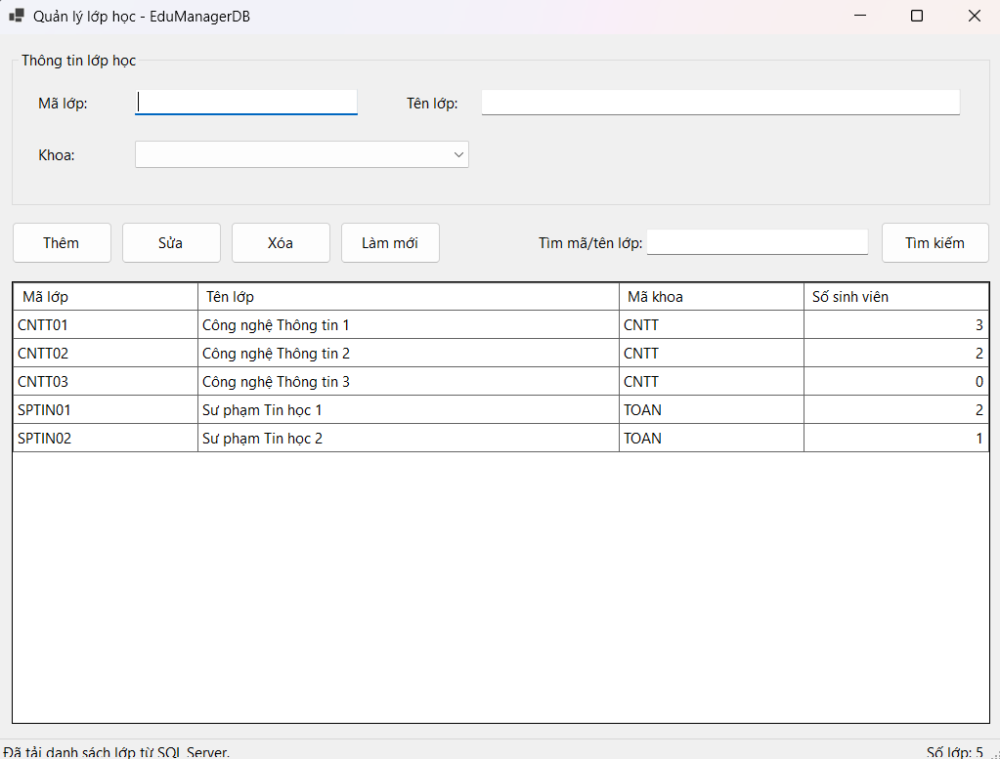

### 6.2. Chọn dòng (F2)

Khi bấm vào một dòng trong lưới, mã lớp, tên lớp và khoa được đưa lên các ô nhập. Ô mã lớp chuyển sang trạng thái chỉ đọc (khóa) vì là khóa chính.

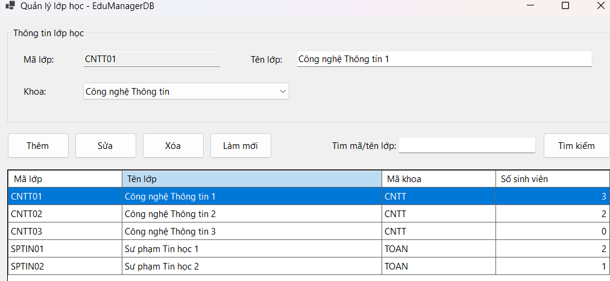

### 6.3. Thêm lớp và kiểm tra dữ liệu nhập (F3)

**Thêm thành công:** lớp mới `TEST01` xuất hiện trong lưới, thanh trạng thái báo "Đã thêm lớp TEST01".

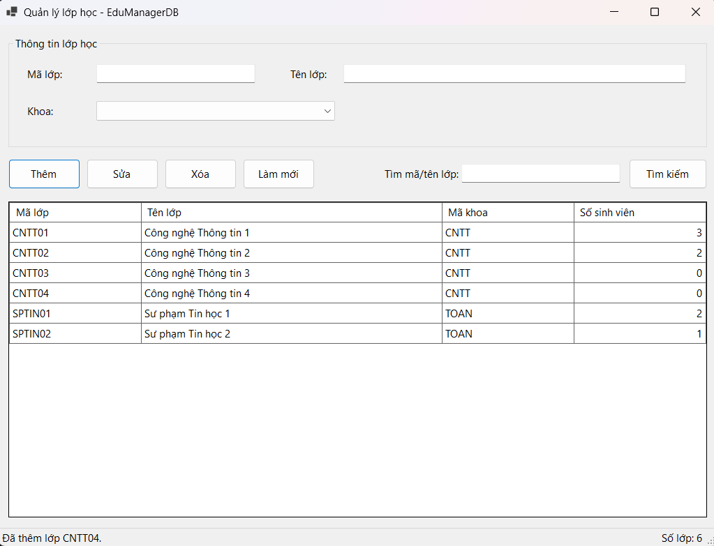

**Dữ liệu được ghi thật vào SQL Server:** truy vấn `SELECT * FROM LOP;` trong SSMS cho thấy lớp `TEST01` đã nằm trong bảng `LOP`.

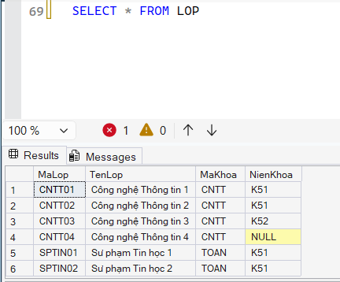

**Kiểm tra dữ liệu nhập:** để trống mã lớp thì chương trình báo thiếu dữ liệu và đưa con trỏ về ô mã lớp.

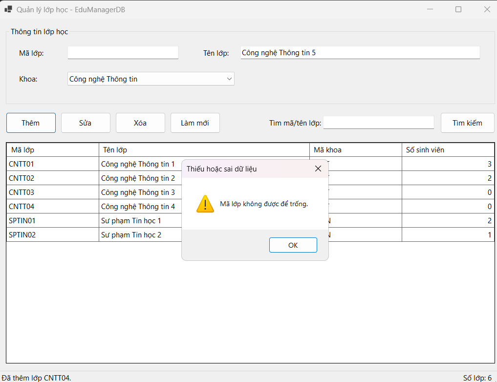

**Kiểm tra trùng mã:** nhập mã `CNTT01` đã có sẵn thì chương trình báo mã lớp đã tồn tại và không thêm.

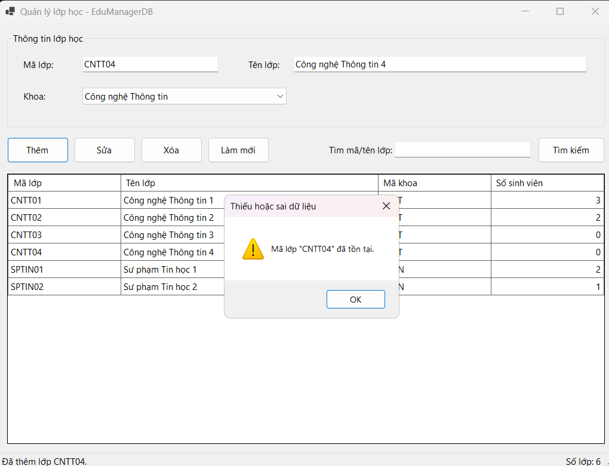

### 6.4. Sửa lớp (F4)

Chọn lớp `TEST01`, đổi tên lớp rồi bấm Sửa: lưới hiển thị tên mới, thanh trạng thái báo "Đã cập nhật lớp TEST01".

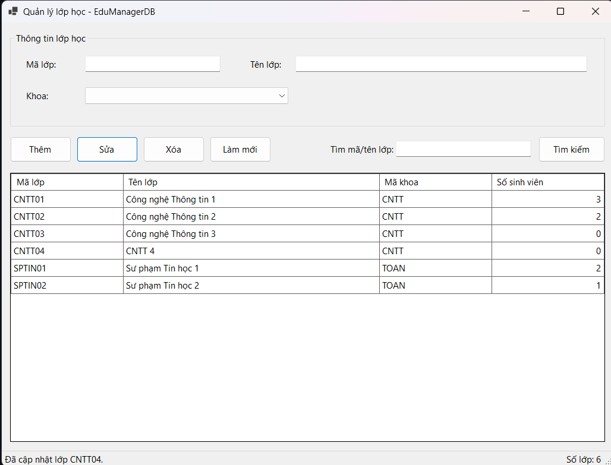

### 6.5. Xóa lớp (F5)

**Không cho xóa lớp đang có sinh viên:** chọn lớp `CNTT01` (đang có 3 sinh viên) và bấm Xóa thì chương trình báo không thể xóa và lớp vẫn còn trong lưới.

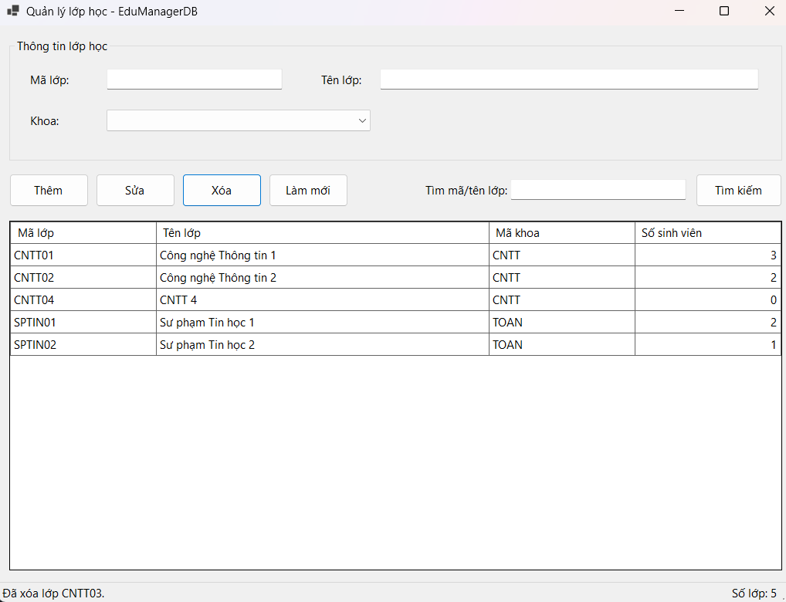

**Xác nhận trước khi xóa:** với lớp không có sinh viên (`TEST01`), chương trình hỏi xác nhận bằng `MessageBox` Yes/No trước khi xóa.

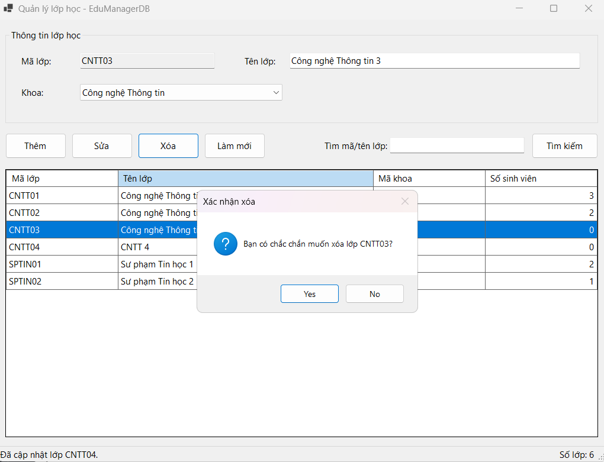

### 6.6. Tìm kiếm (F6, F8)

Nhập từ khóa `CNTT` rồi bấm Tìm kiếm: lưới chỉ còn các lớp có mã hoặc tên chứa từ khóa (CNTT01, CNTT02, CNTT03); thanh trạng thái báo số lớp tìm thấy.

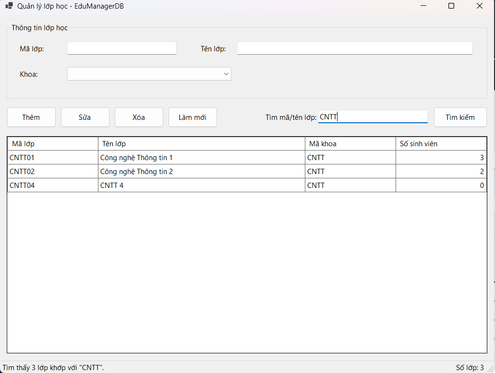

**Chống SQL injection:** nhập chuỗi `' OR 1=1 --` vào ô tìm kiếm. Vì dùng `SqlParameter`, chuỗi này được coi là dữ liệu cần tìm chứ không phải câu lệnh SQL, nên lưới không hiện dòng nào (không bị lộ toàn bộ dữ liệu).

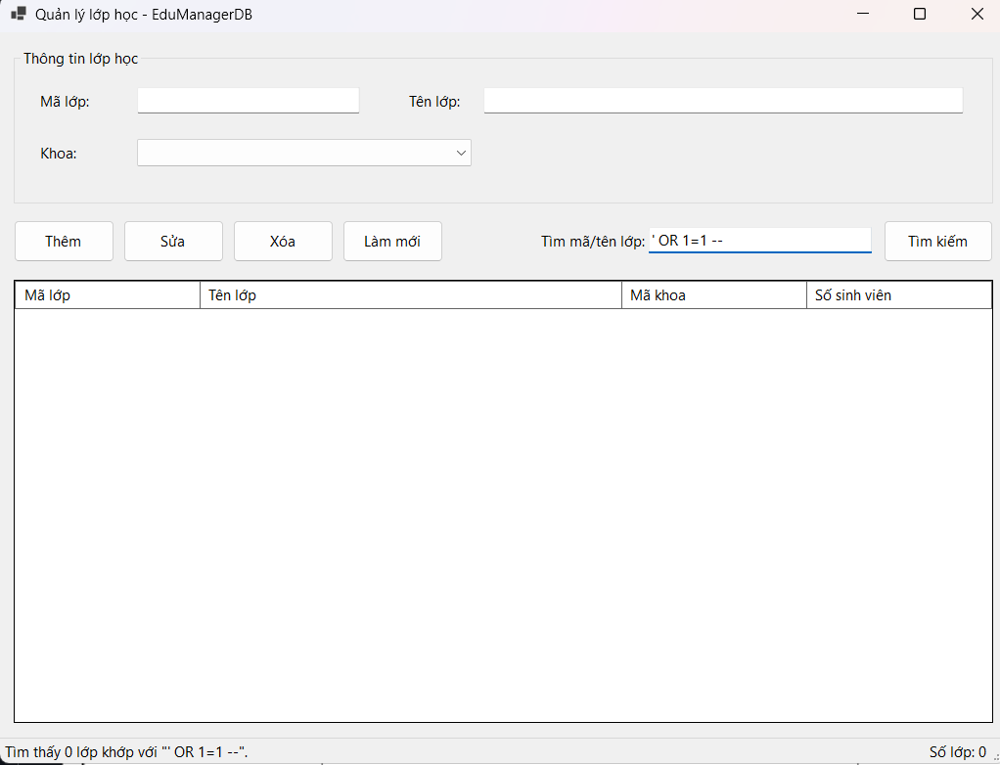

### 6.7. Mã nguồn dùng SqlParameter (F8)

Hàm `InsertLop` khai báo các tham số `@ma`, `@ten`, `@khoa` với kiểu dữ liệu cụ thể, không nối chuỗi dữ liệu vào câu SQL. Các hàm `UpdateLop`, `DeleteLop`, `IsMaLopExists`, `CountSinhVienByLop` và `GetLopTable` (tìm kiếm với `@kw`) viết theo cùng cách.

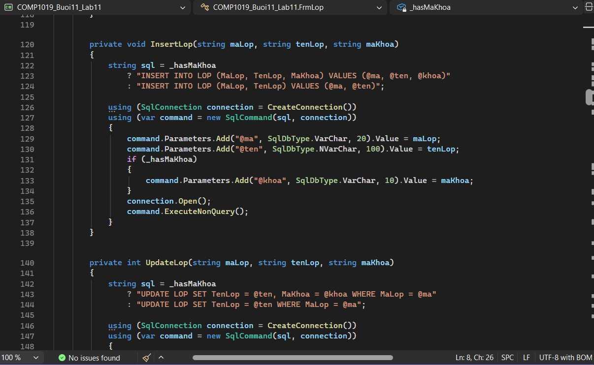

---

## 7. Kiểm thử

Các test case tự kiểm thử (thêm hợp lệ, thiếu mã, thiếu tên, trùng mã, sửa/xóa khi chưa chọn dòng, xóa lớp có sinh viên, tìm kiếm, ký tự đặc biệt, lỗi kết nối...) được liệt kê trong file `TESTCASES.md`.

---

## 8. Hướng dẫn chạy chương trình

1. **Chuẩn bị database:** dùng database `EduManagerDB` của Lab 10 (không cần làm gì thêm). Nếu máy chưa có database thì mở `EduManagerDB.sql` trong SSMS và bấm F5 (script chỉ tạo bảng/dòng nào chưa có, không xóa dữ liệu).
2. **Kiểm tra connection string** trong `COMP1019_Buoi11_Lab11/DbConfig.cs` (dòng 9-10) đúng với tên server của máy (xem mục 3).
3. Mở `COMP1019_Buoi11_Lab11.sln` bằng Visual Studio. Lần build đầu cần Internet để tải package `Microsoft.Data.SqlClient` (đã khai báo sẵn trong `.csproj`).
4. Nhấn **F5** để chạy. Form tự load danh sách lớp từ SQL Server.
5. Nếu không kết nối được, chương trình hiện thông báo kèm gợi ý kiểm tra dịch vụ SQL Server, tên server và database.
