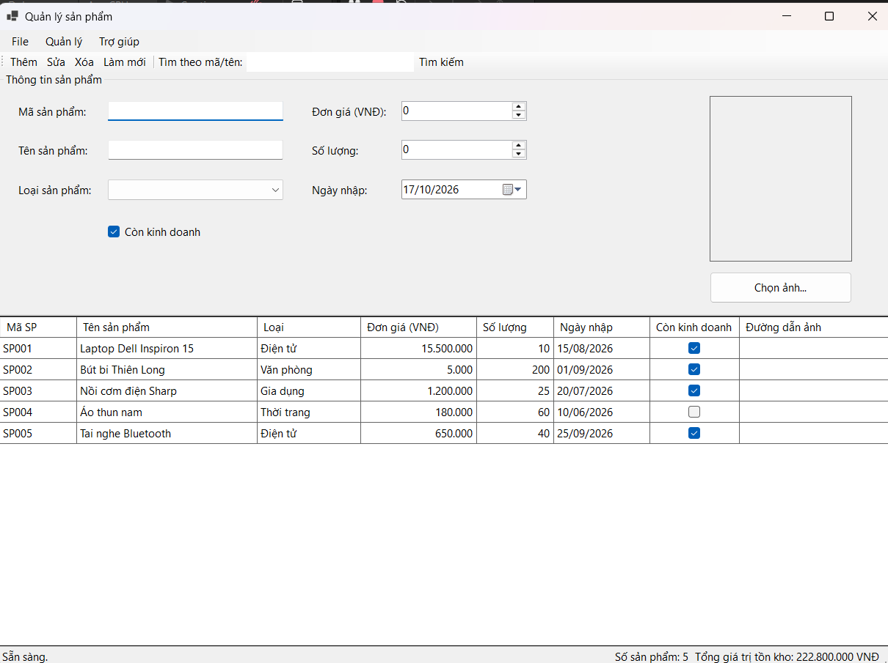
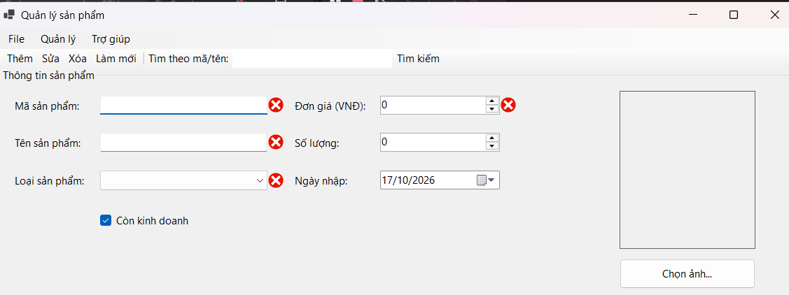
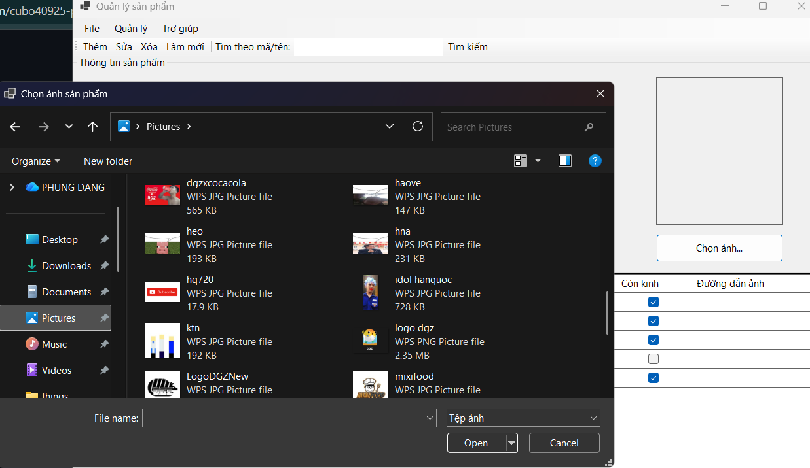
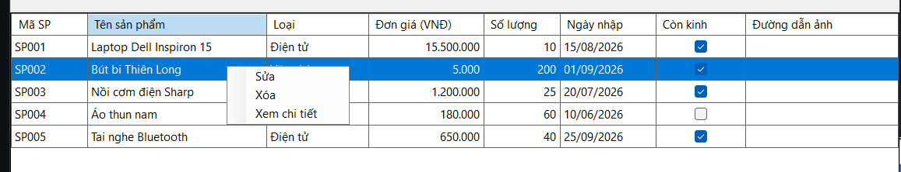
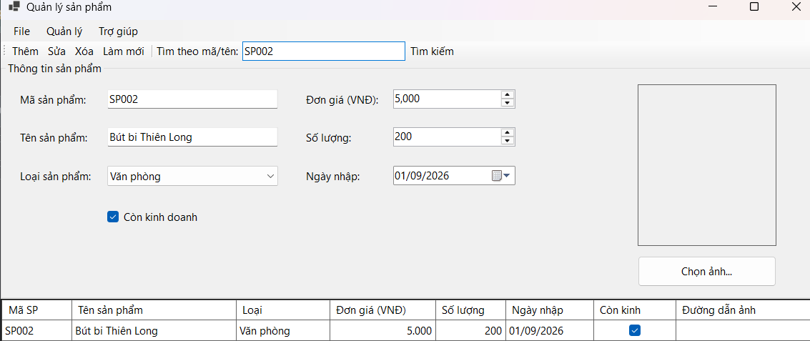
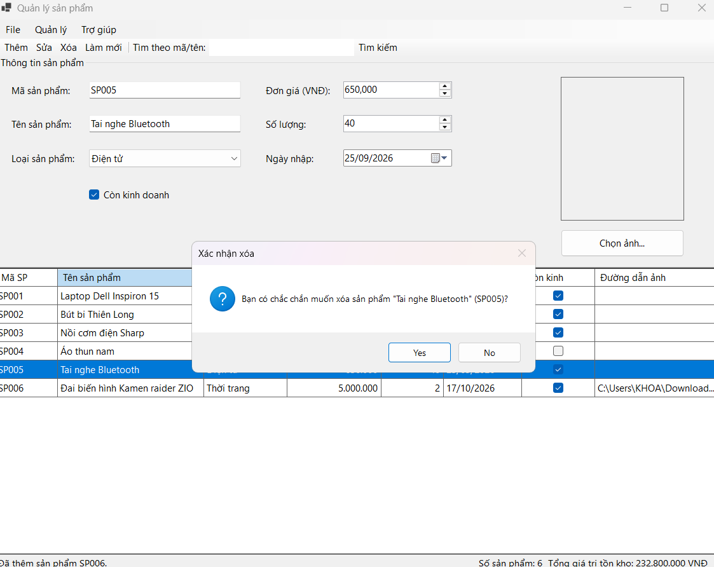
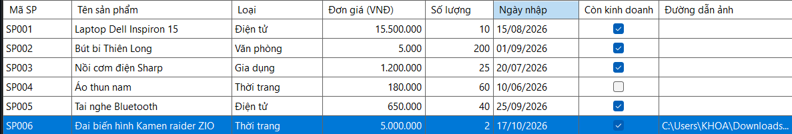

# QUẢN LÝ SẢN PHẨM (PRODUCT MANAGER)

* **Học phần:** 2611COMP101904 - Lập trình trên Windows
* **Giảng viên hướng dẫn:** ThS. Lê Thanh Thoại
* **Sinh viên thực hiện:** Phùng Đăng Khoa - 51.01.104.046
* **Môi trường phát triển:** Microsoft Visual Studio 2022 - C# .NET 8 Windows Forms
* **Form chính:** `FrmProduct.cs` (Giao diện Quản lý Sản phẩm)

---

## 1. Tổng quan Dự án và Điểm nhấn Kỹ thuật

Ứng dụng **ProductManager** dùng để quản lý danh sách sản phẩm của một cửa hàng. Dữ liệu chỉ lưu trong bộ nhớ (chưa kết nối cơ sở dữ liệu), hỗ trợ đầy đủ các thao tác thêm, sửa, xóa, tìm kiếm và làm mới.

- **Điều hướng bằng nhiều thành phần giao diện:** kết hợp `MenuStrip` (File, Quản lý, Trợ giúp), `ToolStrip` (Thêm, Sửa, Xóa, Làm mới, Tìm kiếm) và `StatusStrip` hiển thị trạng thái thao tác, số lượng sản phẩm, tổng giá trị tồn kho.
- **Hiển thị dữ liệu bằng `BindingSource`:** danh sách sản phẩm được gắn vào `DataGridView` thông qua `BindingList<Product>` và `BindingSource`; sau mỗi thao tác thêm/sửa/xóa/tìm kiếm, lưới được nạp lại từ danh sách gốc.
- **Cấu hình `DataGridView` an toàn:** `ReadOnly = true`, `SelectionMode = FullRowSelect`, `MultiSelect = false`, không cho thêm/xóa dòng trực tiếp trên lưới, tránh sửa dữ liệu sai cấu trúc.
- **Kiểm tra dữ liệu bằng `ErrorProvider`:** quét các lỗi để trống, trùng mã, giá trị không hợp lệ, ngày nhập vượt hiện tại; đặt biểu tượng cảnh báo ngay tại control vi phạm và tổng hợp lỗi trong `MessageBox`.
- **Mã nguồn tách hàm rõ ràng:** `ValidateInput`, `ClearInput`, `LoadProductToForm`, `UpdateStatus`, `RefreshGrid`... thay vì viết dồn vào một hàm.

---

## 2. Cấu trúc Dữ liệu (`Product.cs`)

Lớp `Product` lưu thông tin một sản phẩm:

| Tên Thuộc tính | Kiểu dữ liệu | Mô tả & Ràng buộc |
| :--- | :--- | :--- |
| `MaSP` | `string` | Mã sản phẩm, không rỗng, không được trùng (không phân biệt hoa/thường). |
| `TenSP` | `string` | Tên sản phẩm, không được để trống. |
| `LoaiSP` | `string` | Chọn từ ComboBox: *Điện tử, Văn phòng, Gia dụng, Thời trang*. |
| `DonGia` | `decimal` | Đơn giá, phải lớn hơn 0. |
| `SoLuong` | `int` | Số lượng, lớn hơn hoặc bằng 0. |
| `NgayNhap` | `DateTime` | Ngày nhập, không được lớn hơn ngày hiện tại. |
| `ConKinhDoanh` | `bool` | `true`: còn kinh doanh, `false`: ngừng kinh doanh. |
| `DuongDanAnh` | `string` | Đường dẫn ảnh sản phẩm, có thể để trống. |

---

## 3. Danh mục Chức năng

1. **Load Form:** khởi tạo danh sách loại sản phẩm, nạp 5 sản phẩm mẫu và hiển thị lên `DataGridView`.
2. **Thêm sản phẩm:** kiểm tra dữ liệu, kiểm tra mã không trùng, thêm vào danh sách và cập nhật lưới (phím tắt `Ctrl+N`).
3. **Sửa sản phẩm:** chọn một dòng, dữ liệu hiện lên form, chỉnh sửa rồi nhấn **Sửa** để cập nhật (phím tắt `Ctrl+E`). Chưa chọn dòng mà nhấn Sửa thì chỉ hiện thông báo, không báo lỗi chương trình.
4. **Xóa sản phẩm:** chọn một dòng, hiện `MessageBox` xác nhận trước khi xóa (phím tắt `Ctrl+D`, hoặc phím `Delete` khi đang chọn lưới).
5. **Tìm kiếm:** tìm theo **mã** hoặc **tên** sản phẩm, không phân biệt chữ hoa/thường; nhấn nút Tìm kiếm hoặc phím `Enter` trong ô tìm (phím tắt `Ctrl+F` để đưa con trỏ vào ô tìm).
6. **Làm mới:** xóa nội dung nhập, bỏ lỗi `ErrorProvider`, bỏ bộ lọc và hiển thị lại toàn bộ dữ liệu (phím tắt `F5`).
7. **Chọn ảnh:** dùng `OpenFileDialog` chọn file ảnh (.jpg, .jpeg, .png, .bmp, .gif) và hiển thị trong `PictureBox`.
8. **`ContextMenuStrip`:** nhấn chuột phải trên dòng của lưới để chọn *Sửa*, *Xóa* hoặc *Xem chi tiết*; nhấp đúp vào một dòng cũng mở phần xem chi tiết.
9. **`StatusStrip`:** sau mỗi thao tác cập nhật thông điệp trạng thái, số lượng sản phẩm và **tổng giá trị tồn kho** (tổng `DonGia × SoLuong`).
10. **Xuất danh sách:** menu *File → Xuất danh sách ra file .txt* dùng `SaveFileDialog` để lưu toàn bộ danh sách ra tệp văn bản.

---

## 4. Cách chạy chương trình

1. Giải nén và mở file `ProductManager.csproj` bằng Visual Studio 2022 (cần .NET 8 SDK và workload *.NET desktop development*).
2. Nhấn `F5` để chạy.

---

## 5. Minh chứng Thực nghiệm (Test Cases)

Các hình ảnh minh chứng được lưu trong thư mục `images/`.

### 5.1. Khởi tạo giao diện và tải dữ liệu mẫu
Ứng dụng khởi động, tự nạp dữ liệu mẫu lên `DataGridView` và hiển thị trạng thái sẵn sàng trên `StatusStrip`:

### 5.2. Kiểm tra dữ liệu với `ErrorProvider`
Khi để trống thông tin, trùng mã hoặc nhập giá trị không hợp lệ, ứng dụng hiện biểu tượng cảnh báo tại ô vi phạm và thông báo bằng `MessageBox`:

### 5.3. Chọn ảnh sản phẩm (`OpenFileDialog`)
Hộp thoại chọn tệp và ảnh hiển thị trong `PictureBox`:

### 5.4. Menu ngữ cảnh (`ContextMenuStrip`)
Nhấn chuột phải trên một dòng của bảng để chọn nhanh Sửa, Xóa hoặc Xem chi tiết:

### 5.5. Tìm kiếm sản phẩm
Nhập từ khóa mã hoặc tên (không phân biệt hoa/thường), bảng chỉ hiển thị các sản phẩm phù hợp:

### 5.6. Xác nhận trước khi xóa (`MessageBox`)
Hộp thoại Yes/No xuất hiện trước khi xóa sản phẩm:

### 5.7. Cập nhật `StatusStrip`
Thanh trạng thái hiển thị thông điệp sau mỗi thao tác, số lượng sản phẩm và tổng giá trị tồn kho:

