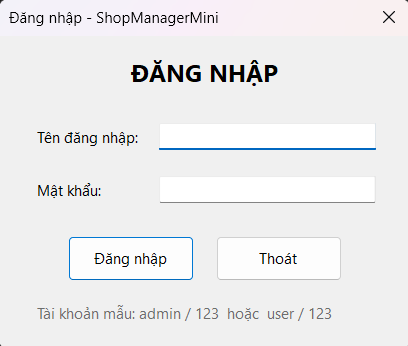
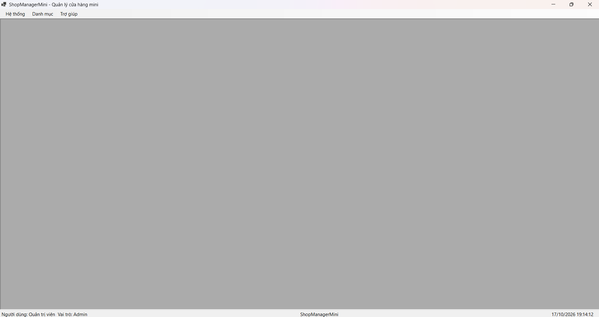
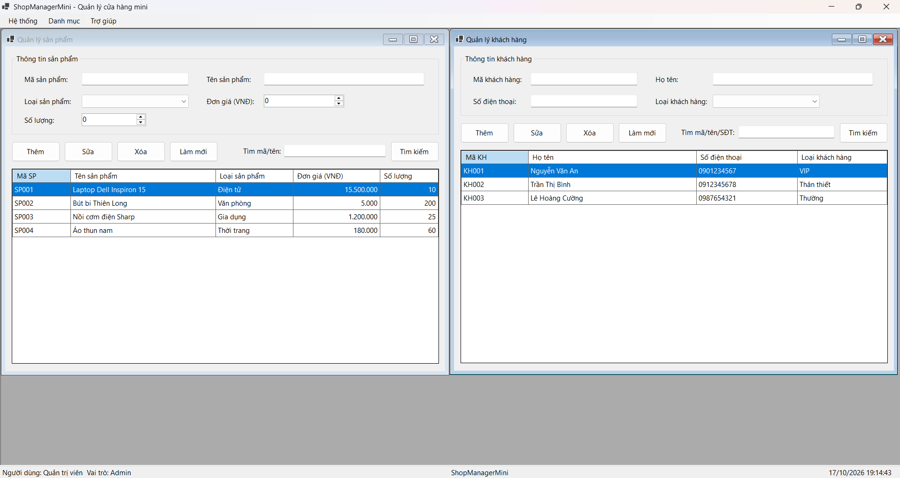
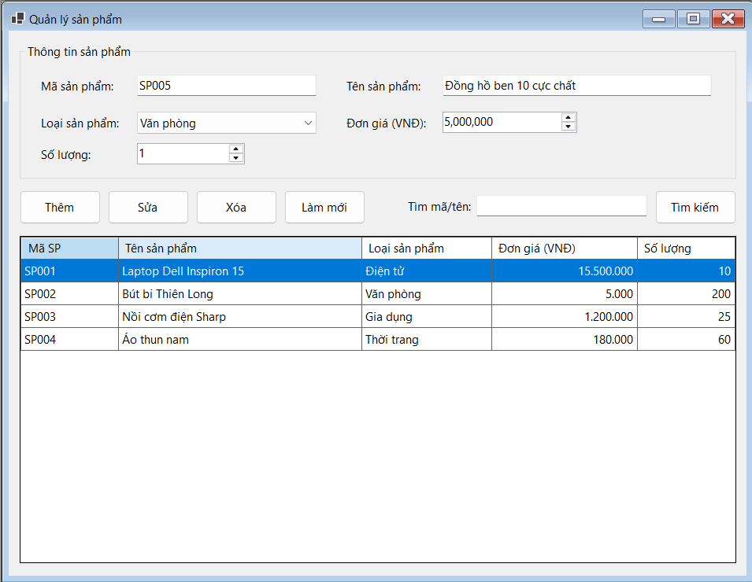
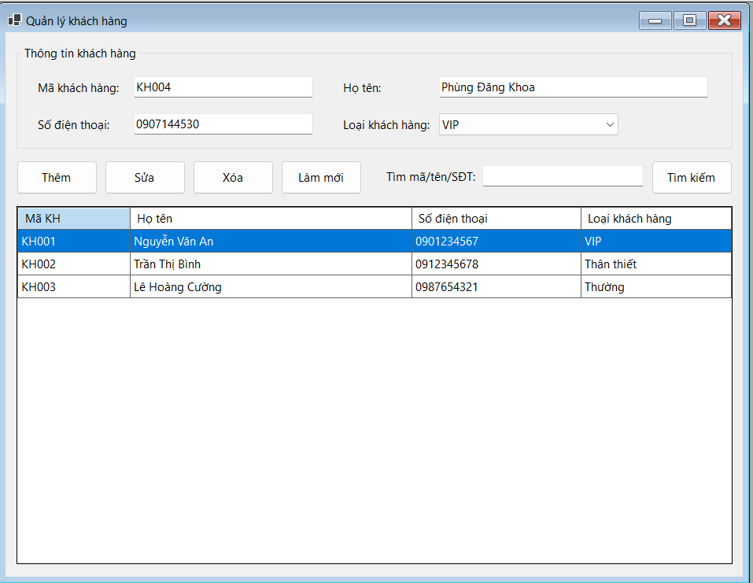
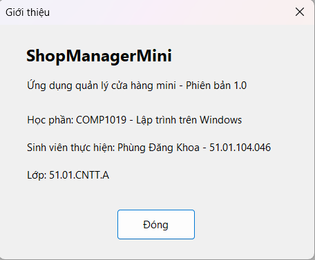
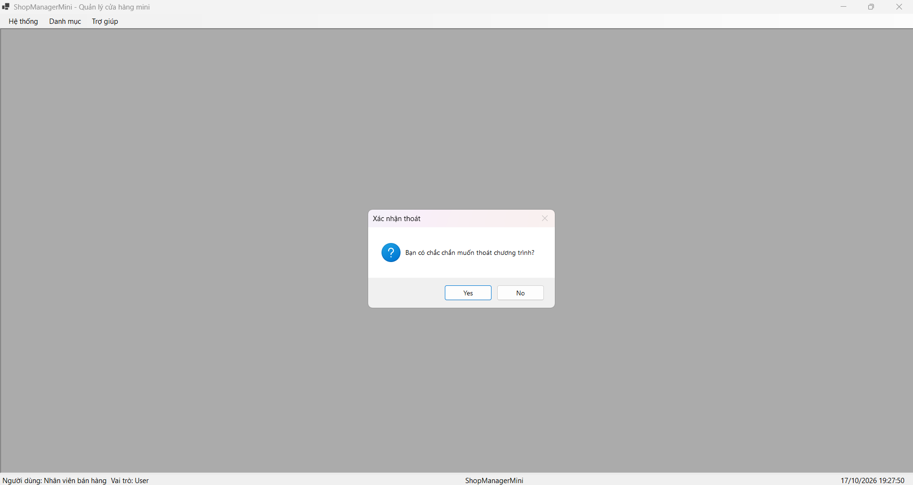
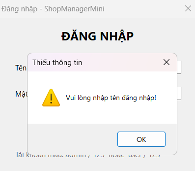
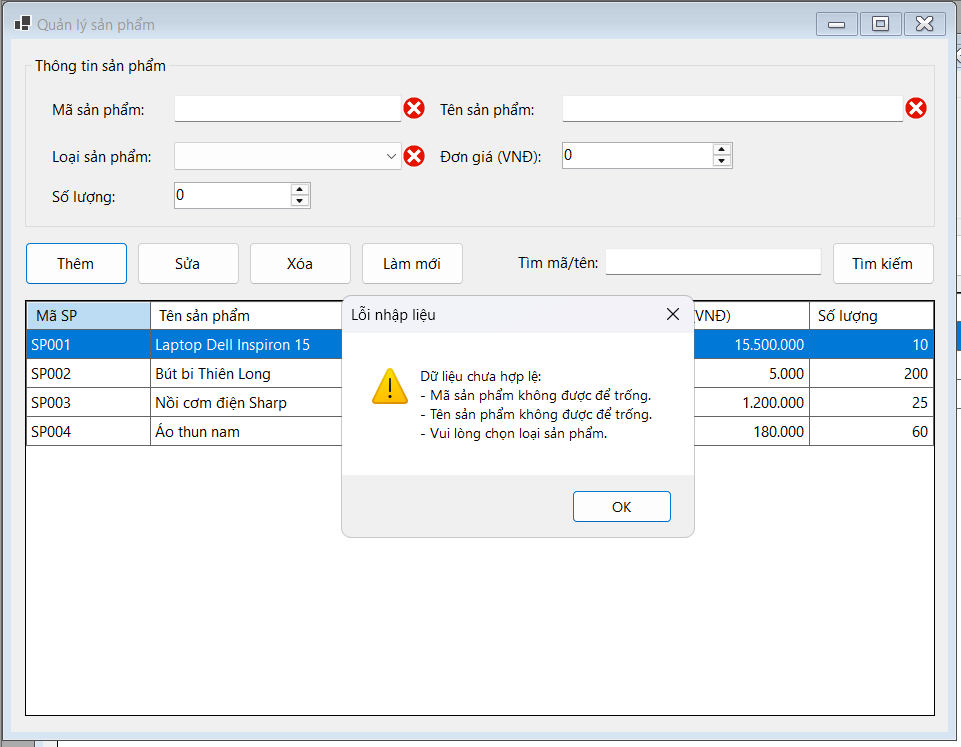
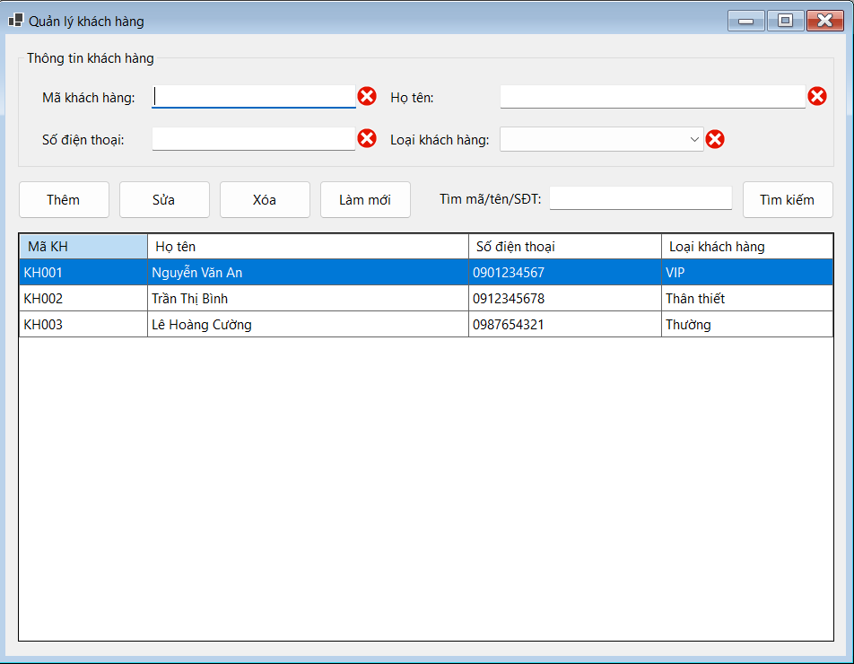

# QUẢN LÝ CỬA HÀNG MINI (SHOP MANAGER MINI)

* **Học phần:** 2611COMP101904 - Lập trình trên Windows
* **Giảng viên hướng dẫn:** ThS. Lê Thanh Thoại
* **Sinh viên thực hiện:** Phùng Đăng Khoa - 51.01.104.046
* **Môi trường phát triển:** Microsoft Visual Studio 2022 - C# .NET 8 Windows Forms App
* **Tên ứng dụng:** `ShopManagerMini`

\---

## 1\. Giới thiệu và Kiến trúc Hệ thống

`ShopManagerMini` là ứng dụng quản lý cửa hàng mini gồm nhiều Form, áp dụng mô hình MDI (Multiple Document Interface). Dữ liệu chỉ lưu trong bộ nhớ, chưa kết nối cơ sở dữ liệu.

* **Mô hình MDI Parent - Child:** `FrmMain` là Form cha (`IsMdiContainer = true`), các Form con (`FrmProduct`, `FrmCustomer`) chỉ hiển thị bên trong vùng làm việc của Form cha, không mở thành cửa sổ rời.
* **Đăng nhập bằng hộp thoại modal:** `FrmLogin` được mở bằng `ShowDialog()`. Khi đăng nhập đúng, Form gán `DialogResult.OK` và lưu đối tượng `User` vào property `LoggedInUser`; `Program.cs` đọc property này rồi truyền sang `FrmMain` qua constructor.
* **Không mở trùng Form con:** hàm `OpenChildForm<T>()` duyệt tập `MdiChildren`; nếu Form cùng loại đã mở thì gọi `Activate()` thay vì tạo Form mới.
* **Đăng xuất và thoát an toàn:** Đăng xuất đưa người dùng về lại `FrmLogin`; Thoát (hoặc đóng cửa sổ) đều hỏi xác nhận bằng `MessageBox`.
* **Dữ liệu trong bộ nhớ:** lớp tĩnh `DataStore` giữ danh sách `User`, `Product`, `Customer`. Các Form hiển thị lên `DataGridView` bằng `BindingList` và `BindingSource`, nên đóng rồi mở lại Form con thì dữ liệu vẫn còn.

### Cấu trúc project

```
ShopManagerMini
|-- Models
|   |-- User.cs
|   |-- Product.cs
|   |-- Customer.cs
|-- Data
|   |-- DataStore.cs
|-- Forms
|   |-- FrmLogin.cs
|   |-- FrmMain.cs
|   |-- FrmProduct.cs
|   |-- FrmCustomer.cs
|   |-- FrmAbout.cs
|-- Program.cs
```

### Tài khoản đăng nhập mẫu

|Username|Password|Họ tên|Vai trò|
|-|-|-|-|
|`admin`|`123`|Quản trị viên|Admin|
|`user`|`123`|Nhân viên bán hàng|User|

\---

## 2\. Danh mục Form và Chức năng

|Tên Form|Vai trò|Chức năng chính|
|-|-|-|
|`FrmLogin`|Hộp thoại modal|Nhập username/password, cảnh báo khi bỏ trống, báo lỗi khi sai tài khoản, trả `DialogResult.OK` khi đúng.|
|`FrmMain`|MDI Parent|Có `MenuStrip` (Hệ thống, Danh mục, Trợ giúp) và `StatusStrip` hiển thị tên người dùng, vai trò, đồng hồ; mở và quản lý các Form con.|
|`FrmProduct`|MDI Child|Quản lý sản phẩm: Thêm, Sửa, Xóa, Làm mới, Tìm kiếm trên `DataGridView`; kiểm tra mã trùng, đơn giá và số lượng không âm; xác nhận trước khi xóa.|
|`FrmCustomer`|MDI Child|Quản lý khách hàng (mã, họ tên, số điện thoại, loại khách hàng): Thêm, Sửa, Xóa, Làm mới, Tìm kiếm, kiểm tra dữ liệu.|
|`FrmAbout`|Hộp thoại|Hiển thị thông tin ứng dụng, tên sinh viên và lớp.|

\---

## 3\. Minh chứng Thực nghiệm (Test Cases)

Các hình ảnh minh chứng được lưu trong thư mục `images/`.

### 3.1. Giao diện đăng nhập (`FrmLogin`)



### 3.2. Form chính MDI (`FrmMain`)

Các Form nghiệp vụ được mở bên trong vùng làm việc của `FrmMain`, không mở thành cửa sổ rời:



### 3.3. Quản lý sản phẩm và khách hàng

Hai Form con cùng mở trong `FrmMain`:



### 3.4. Thêm dữ liệu

* Quản lý sản phẩm (thêm mới, cập nhật đơn giá, số lượng):

  

* Quản lý khách hàng (mã, họ tên, số điện thoại, loại khách hàng):

  

### 3.5. Giới thiệu ứng dụng (`FrmAbout`)



### 3.6. Xác nhận thoát chương trình

Hộp thoại xác nhận hiển thị khi người dùng chọn Thoát hoặc đóng cửa sổ chính:



### 3.7. Kiểm tra dữ liệu và xử lý lỗi

* Cảnh báo khi bỏ trống thông tin ở màn hình đăng nhập:

  

* Báo lỗi khi nhập thiếu hoặc sai dữ liệu ở Form Quản lý sản phẩm:

  

* Báo lỗi khi nhập thiếu hoặc sai dữ liệu ở Form Quản lý khách hàng:

  

\---

## 4\. Câu hỏi nộp kèm

### Câu 1: SDI và MDI khác nhau như thế nào?

**SDI (Single Document Interface):** mỗi Form là một cửa sổ độc lập, có nút đóng, thu nhỏ, phóng to riêng và nằm ngang hàng nhau trên màn hình. Đóng Form này không ảnh hưởng các Form khác.

**MDI (Multiple Document Interface):** có một Form cha làm khung chứa (`IsMdiContainer = true`). Các Form con chỉ hiển thị và thao tác bên trong vùng làm việc của Form cha, không kéo ra ngoài được. Khi đóng Form cha thì các Form con bên trong cũng bị đóng theo.

### Câu 2: Vì sao Form đăng nhập nên dùng ShowDialog()?

`ShowDialog()` hiển thị Form dạng modal nên phù hợp với Form đăng nhập vì:

1. **Chặn thao tác ở Form khác:** người dùng phải xử lý xong Form đăng nhập (đăng nhập hoặc thoát) rồi mới tiếp tục.
2. **Có giá trị trả về:** `ShowDialog()` trả về `DialogResult` (OK hoặc Cancel) để chương trình quyết định có mở Form chính hay không.
3. **Luồng khởi động tuần tự:** đăng nhập thành công, đóng Form đăng nhập, rồi mới mở `FrmMain`.

### Câu 3: Dữ liệu user được truyền từ FrmLogin sang FrmMain bằng cách nào?

1. Khi tài khoản hợp lệ, `FrmLogin` lưu đối tượng người dùng vào property `public User LoggedInUser { get; private set; }` và gán `DialogResult = DialogResult.OK` để đóng Form.
2. Trong `Program.cs`, sau khi `ShowDialog()` trả về `OK`, chương trình đọc `login.LoggedInUser`.
3. Đối tượng này được truyền vào constructor của Form chính: `new FrmMain(login.LoggedInUser)`. `FrmMain` dùng nó để hiển thị tên và vai trò trên `StatusStrip`.

### Câu 4: Nếu người dùng bấm menu sản phẩm nhiều lần, chương trình xử lý thế nào để không mở trùng Form?

Hàm `OpenChildForm<T>()` duyệt qua `MdiChildren` trước khi tạo Form mới. Nếu đã có Form cùng kiểu `T` thì chương trình khôi phục trạng thái bình thường (nếu đang thu nhỏ) và gọi `Activate()` để đưa Form đó lên trước, rồi thoát hàm. Chỉ khi chưa có Form cùng loại thì mới tạo Form mới, gán `MdiParent = this` và gọi `Show()`.

### Câu 5: Khi nào nên dùng constructor, khi nào nên dùng property để truyền dữ liệu giữa các Form?

* **Constructor:** dùng khi dữ liệu bắt buộc phải có ngay từ lúc tạo Form để Form hoạt động đúng, ví dụ truyền thông tin user đăng nhập cho `FrmMain`. Cách này buộc người gọi phải cung cấp dữ liệu từ đầu.
* **Property:** dùng khi dữ liệu là tùy chọn hoặc có thể thay đổi sau khi Form đã được tạo, hoặc khi cần lấy kết quả từ Form con trả về Form gọi, ví dụ `LoggedInUser` của `FrmLogin`.

\---

## 5\. Cách chạy chương trình

1. Giải nén và mở file `ShopManagerMini.csproj` bằng Visual Studio 2022 (cần .NET 8 SDK và workload *.NET desktop development*).
2. Nhấn `F5` để chạy, đăng nhập bằng `admin / 123` hoặc `user / 123`.

