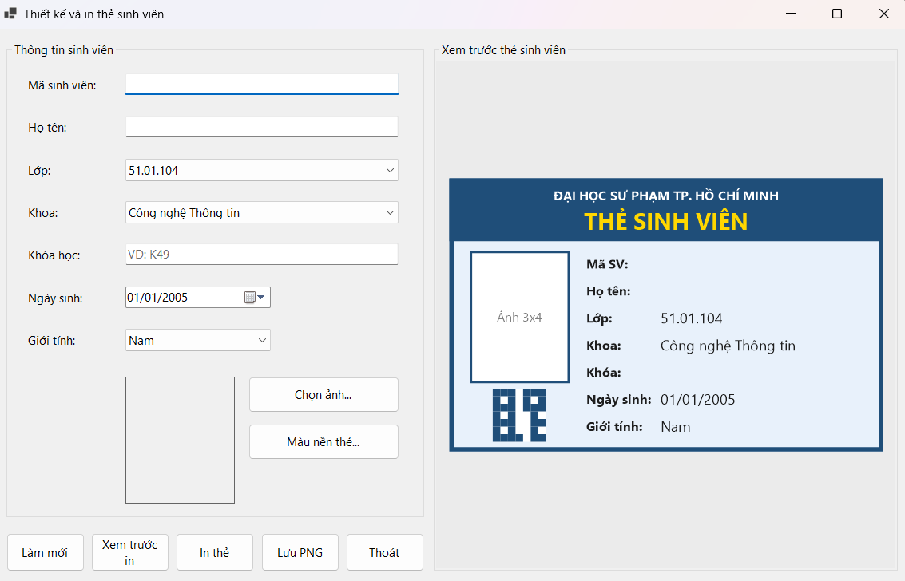
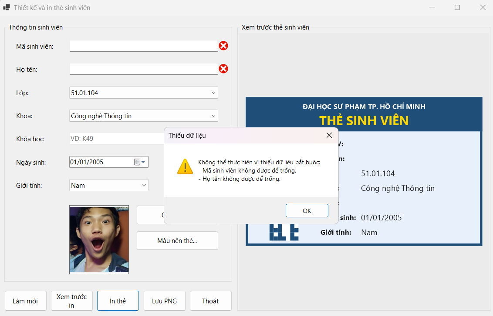
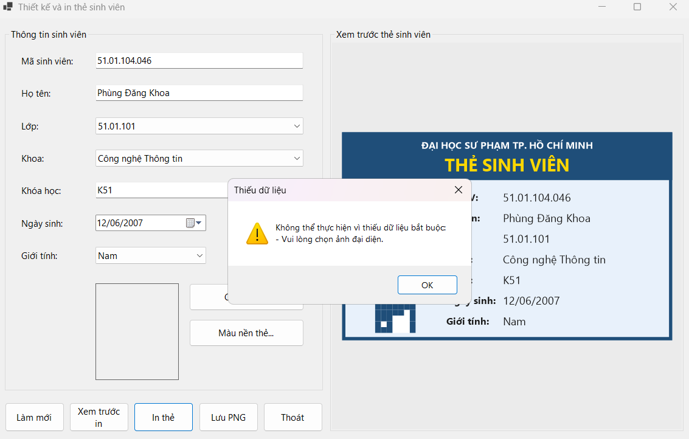
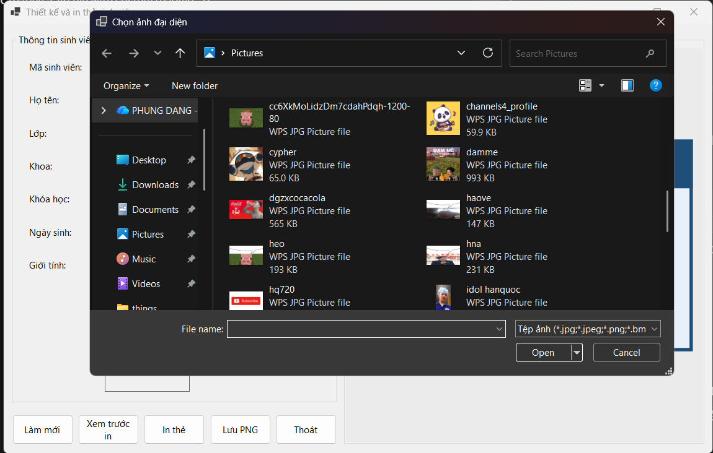
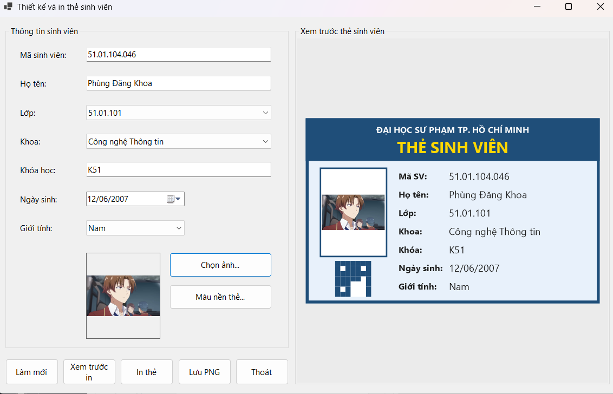
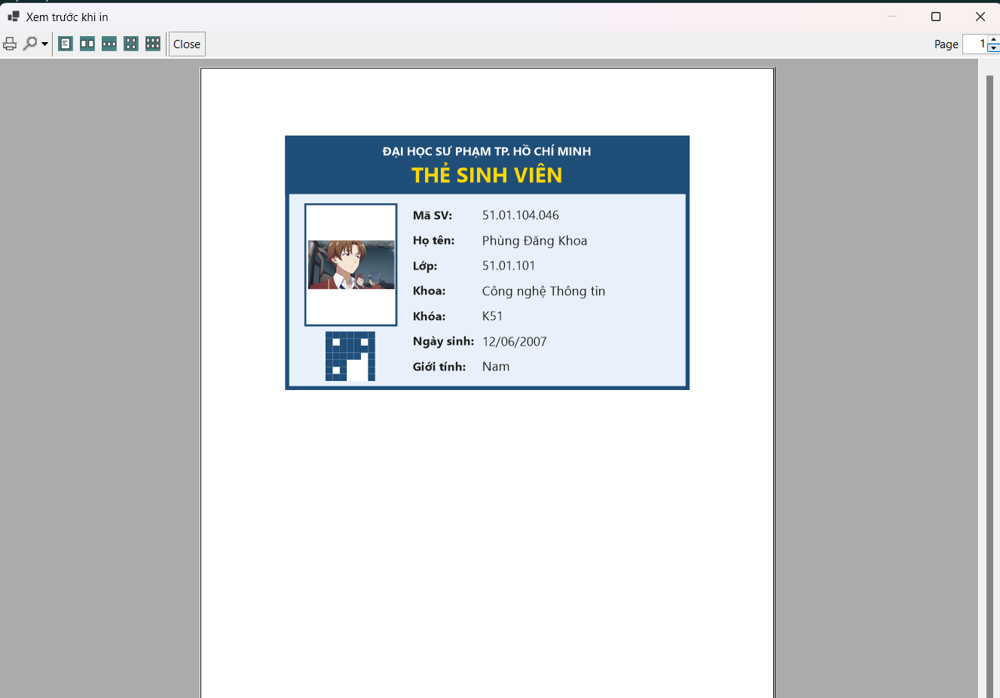
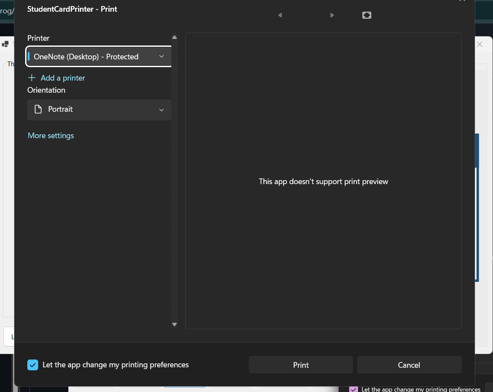
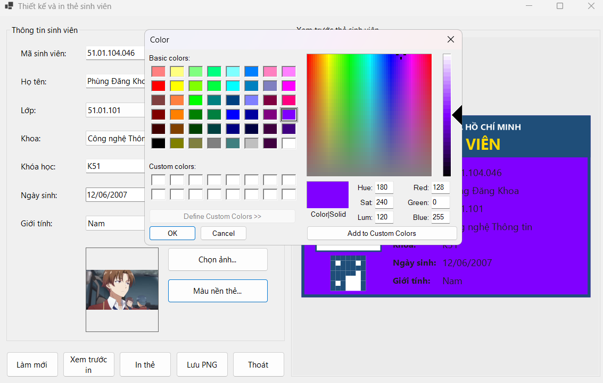
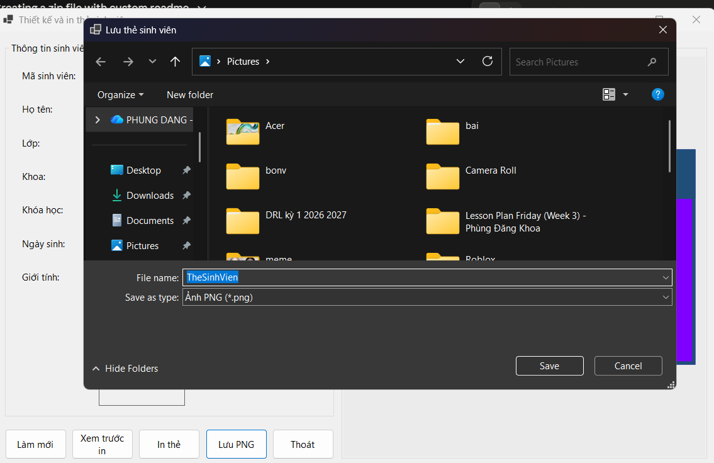
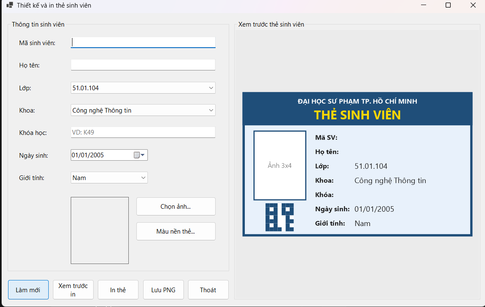

# THIẾT KẾ VÀ IN THẺ SINH VIÊN (STUDENT CARD PRINTER)

* **Môn học:** COMP1019 - Lập trình trên Windows
* **Giảng viên hướng dẫn:** ThS. Lê Thanh Thoại
* **Sinh viên thực hiện:** Phùng Đăng Khoa - 51.01.104.046
* **Môi trường phát triển:** Microsoft Visual Studio 2022 - C# .NET 8 Windows Forms App, GDI+
* **Tên ứng dụng:** `StudentCardPrinter`
* **Form chính:** `FrmStudentCard`

---

## 1. Mô tả Chức năng và Kiến trúc Hệ thống

`StudentCardPrinter` cho phép nhập thông tin sinh viên, chọn ảnh đại diện, xem trước thẻ sinh viên theo thời gian thực và in thẻ. Dữ liệu nhập trực tiếp trên Form, không dùng cơ sở dữ liệu.

- **Dữ liệu tập trung (`StudentCardInfo`):** lưu mã sinh viên, họ tên, lớp, khoa, khóa học, ngày sinh, giới tính, ảnh. Cùng một đối tượng này được dùng để vẽ preview, in ấn và lưu PNG.
- **Vẽ thẻ bằng GDI+ (`CardRenderer`):** hàm `CardRenderer.Draw` vẽ thẻ (tiêu đề, khung, ảnh, thông tin, mã QR giả lập) trong không gian thiết kế 400 × 252 rồi co giãn theo vùng vẽ. Nhờ vậy thẻ trên Panel, trên bản in và trong file PNG có bố cục giống nhau.
- **Preview thời gian thực:** mỗi khi nhập, đổi lựa chọn, đổi ảnh hoặc đổi màu nền, chương trình gọi `pnlCardPreview.Invalidate()` để vẽ lại thẻ trong sự kiện `Paint`. Panel là `DoubleBufferedPanel` nên không bị nhấp nháy.
- **Xử lý ảnh an toàn:** `OpenFileDialog` chỉ cho chọn file JPG, JPEG, PNG, BMP. Ảnh được sao chép sang `new Bitmap(temp)` nên không khóa file gốc; ảnh cũ được `Dispose` khi đổi ảnh. `PictureBox` dùng `SizeMode = Zoom`, còn trên thẻ ảnh được vẽ theo đúng tỉ lệ nên không bị méo, kể cả khi in.
- **In ấn:** `PrintDocument` định nghĩa nội dung in (sự kiện `PrintPage`), `PrintPreviewDialog` để xem trước, `PrintDialog` để chọn máy in. Thẻ in đúng tỉ lệ thẻ ngang, rộng tối đa 6 inch, đặt giữa trang.
- **Kiểm tra dữ liệu (`ErrorProvider` + `MessageBox`):** không cho xem trước in, in hoặc lưu PNG khi thiếu mã sinh viên, họ tên hoặc ảnh đại diện.

---

## 2. Danh mục Thành phần Điều khiển (Controls)

| Thành phần | Tên control | Chức năng chính |
| :--- | :--- | :--- |
| `TextBox` | `txtStudentId`, `txtFullName`, `txtCourse` | Nhập mã sinh viên, họ tên, khóa học (VD: K49). |
| `ComboBox` | `cboClass`, `cboFaculty`, `cboGender` | Chọn lớp, khoa, giới tính (Nam/Nữ/Khác). |
| `DateTimePicker` | `dtpBirthDate` | Chọn ngày sinh (không lớn hơn ngày hiện tại). |
| `PictureBox` | `picAvatar` | Hiển thị ảnh đại diện với chế độ `Zoom`. |
| `Panel` | `pnlCardPreview` | Vùng vẽ preview thẻ sinh viên bằng GDI+. |
| `Button` | `btnChoosePhoto` | Chọn ảnh đại diện bằng `OpenFileDialog`. |
| `Button` | `btnCardColor` | Chọn màu nền thẻ bằng `ColorDialog` (nâng cao). |
| `Button` | `btnClear` | Làm mới: xóa dữ liệu nhập, xóa ảnh, đưa Form về trạng thái ban đầu. |
| `Button` | `btnPreviewPrint` | Mở `PrintPreviewDialog` để xem trước khi in. |
| `Button` | `btnPrint` | Mở `PrintDialog` và in bằng `PrintDocument`. |
| `Button` | `btnSavePng` | Lưu thẻ ra file PNG bằng `SaveFileDialog` (nâng cao). |
| `Button` | `btnExit` | Thoát chương trình (có hỏi xác nhận). |
| `PrintDocument` | `printDocument1` | Định nghĩa nội dung cần in. |
| `PrintPreviewDialog` | `printPreviewDialog1` | Xem trước bản in. |
| `PrintDialog` | `printDialog1` | Chọn máy in hoặc `Microsoft Print to PDF`. |
| `ErrorProvider` | `errorProvider` | Hiện biểu tượng cảnh báo tại control bị thiếu dữ liệu. |

---

## 3. Cách chạy chương trình

1. Giải nén và mở file `StudentCardPrinter.csproj` bằng Visual Studio 2022 (cần .NET 8 SDK và workload *.NET desktop development*).
2. Nhấn `Ctrl + Shift + B` để build, sau đó nhấn `F5` để chạy.
3. Nhập mã sinh viên, họ tên, chọn lớp, khoa, khóa học, ngày sinh, giới tính và bấm **Chọn ảnh...**; thẻ ở bên phải cập nhật ngay khi thay đổi dữ liệu.
4. Bấm **Xem trước in** để xem bản in, hoặc **In thẻ** để chọn máy in (có thể chọn `Microsoft Print to PDF` nếu không có máy in thật).

---

## 4. Test Case và Minh chứng Thực nghiệm

### 4.1. Bảng test case

| Mã | Chức năng | Thao tác | Kết quả mong đợi | Ảnh | Kết quả |
| :--- | :--- | :--- | :--- | :--- | :--- |
| TC01 | Khởi tạo giao diện | Chạy chương trình | Form chia 2 vùng: nhập liệu bên trái, preview thẻ bên phải; các ComboBox có giá trị mặc định | `1.png` | |
| TC02 | Validation mã SV | Để trống Mã SV, bấm **Xem trước in** | Hiện `MessageBox` báo thiếu mã SV, có biểu tượng lỗi ở ô mã SV, không mở xem trước in | `2.png` | |
| TC03 | Validation họ tên | Để trống Họ tên, bấm **Xem trước in** | Hiện `MessageBox` báo thiếu họ tên, có biểu tượng lỗi ở ô họ tên | `2.png` | |
| TC04 | Validation ảnh | Nhập đủ mã SV, họ tên nhưng chưa chọn ảnh, bấm **In thẻ** | Hiện `MessageBox` yêu cầu chọn ảnh đại diện, không mở hộp thoại in | `3.png` | |
| TC05 | Chọn ảnh | Bấm **Chọn ảnh...**, chọn file JPG/PNG/BMP | Ảnh hiện trong `PictureBox` không bị méo, đồng thời xuất hiện trên thẻ | `4.png` | |
| TC06 | Preview thẻ GDI+ | Nhập đầy đủ thông tin hợp lệ và chọn ảnh | Panel vẽ đủ khung viền, tiêu đề, ảnh, thông tin sinh viên; thay đổi dữ liệu thì thẻ cập nhật ngay | `5.png` | |
| TC07 | Xem trước khi in | Bấm **Xem trước in** khi dữ liệu hợp lệ | Mở `PrintPreviewDialog` hiển thị thẻ đúng bố cục, ảnh không méo | `6.png` | |
| TC08 | In thẻ | Bấm **In thẻ** khi dữ liệu hợp lệ | Mở `PrintDialog` cho chọn máy in; bấm OK thì thẻ được gửi tới máy in | `7.png` | |
| TC09 | Đổi màu nền thẻ | Bấm **Màu nền thẻ...**, chọn màu khác | Màu nền thẻ trên preview đổi theo, chữ tự đổi sáng/tối cho dễ đọc | `8.png` | |
| TC10 | Lưu thẻ ra PNG | Bấm **Lưu PNG**, chọn nơi lưu | File PNG được tạo, hình thẻ giống preview | `9.png` | |
| TC11 | Làm mới | Bấm **Làm mới** sau khi đã nhập dữ liệu | Xóa dữ liệu nhập, xóa ảnh, đưa màu nền và các lựa chọn về ban đầu | `10.png` | |

> Sau khi tự chạy thử từng test case, điền `Đạt` hoặc `Không đạt` vào cột **Kết quả**.

### 4.2. Khởi tạo giao diện ứng dụng (TC01)
Giao diện chia thành hai vùng: nhập liệu bên trái, xem trước thẻ bên phải:

### 4.3. Kiểm tra dữ liệu bắt buộc (TC02, TC03, TC04)
- Thiếu mã sinh viên và họ tên:

  

- Chưa chọn ảnh đại diện:

  

### 4.4. Chọn ảnh đại diện bằng `OpenFileDialog` (TC05)
Ảnh hiển thị trong `PictureBox` theo chế độ `Zoom`, không bị méo:

### 4.5. Xem trước thẻ bằng GDI+ (TC06)
Panel vẽ thẻ gồm khung viền, tiêu đề, ảnh chân dung và thông tin chi tiết:

### 4.6. Cửa sổ xem trước khi in (TC07)

### 4.7. Hộp thoại chọn máy in (TC08)
Có thể chọn máy in thật hoặc `Microsoft Print to PDF`:

### 4.8. Đổi màu nền thẻ - tính năng nâng cao (TC09)

### 4.9. Lưu thẻ ra file PNG - tính năng nâng cao (TC10)

### 4.10. Làm mới Form (TC11)

