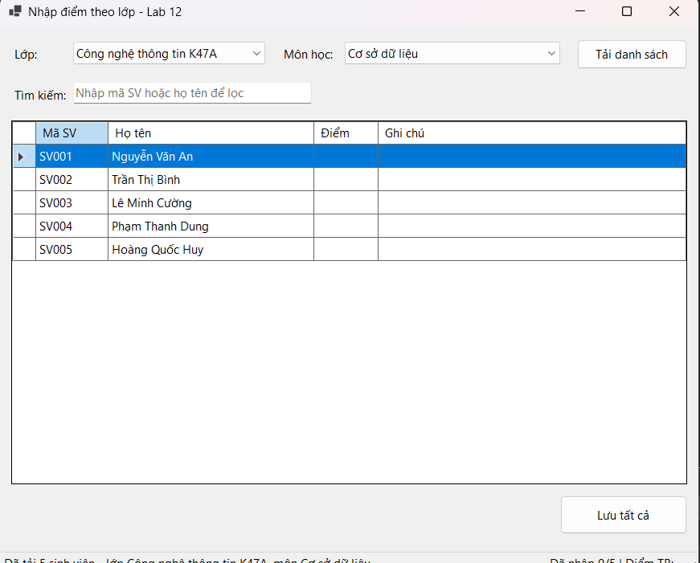
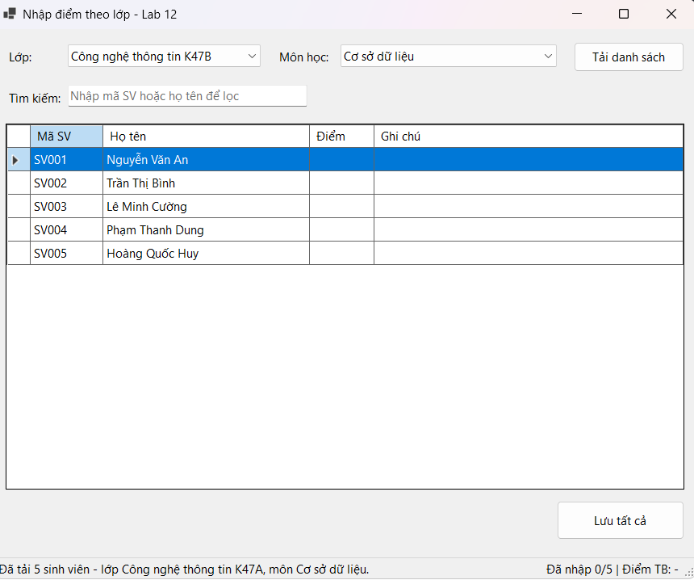
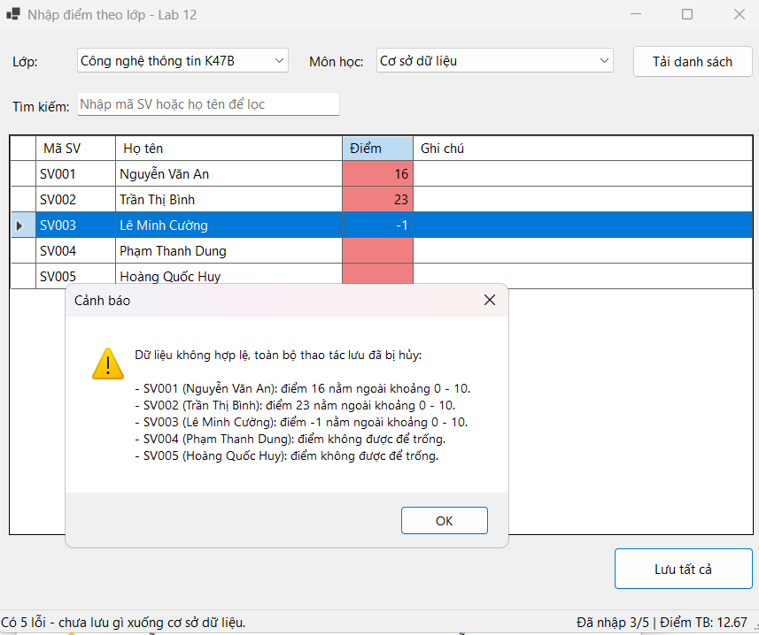
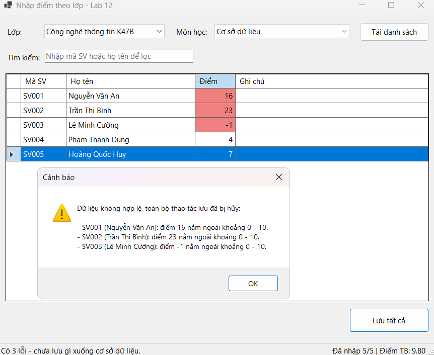
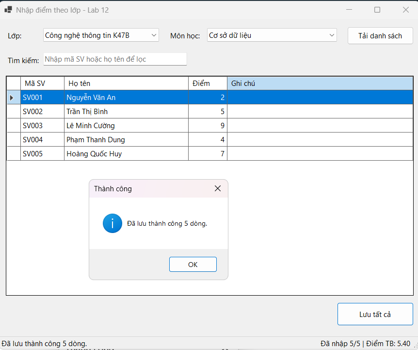
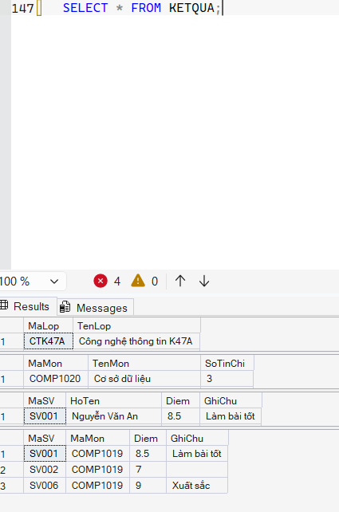

# BÁO CÁO THỰC HÀNH LAB 12: DATA BINDING, STORED PROCEDURE & TRANSACTION

- **Học phần:** COMP1019 - Lập trình trên Windows
- **Giảng viên hướng dẫn:** ThS. Lê Thanh Thoại
- **Sinh viên thực hiện:** Phùng Đăng Khoa - 51.01.104.046
- **Môi trường phát triển:** Microsoft Visual Studio (C# WinForms, .NET 8) & Microsoft SQL Server (SSMS)
- **Thư viện kết nối:** `Microsoft.Data.SqlClient`
- **Cơ sở dữ liệu:** `QLSinhVienLab12`

---

## 1. Cấu trúc Dự án (Project Organization)

Dự án tuân thủ mô hình phân tầng rõ ràng, tách biệt giữa giao diện người dùng và tầng truy xuất dữ liệu (Clean Code):

```text
QLSinhVienLab12/
│
├── QLSinhVienLab12.sln                 # Solution dự án Visual Studio
├── README.md                          # Tài liệu báo cáo kỹ thuật
│
├── Database/
│   └── QLSinhVienLab12.sql              # Script DDL, DML, ràng buộc và 4 Stored Procedures
│
├── Images/                            # Thư mục chứa ảnh chụp minh chứng thực nghiệm
│   ├── 1.png  # Giao diện tải danh sách lớp CTK47A
│   ├── 2.png  # Giao diện tải danh sách lớp CTK47B
│   ├── 3.png  # Bẫy lỗi Validation (không lưu gì xuống CSDL)
│   ├── 4.png  # Form trước khi lưu
│   ├── 5.png  # Lưu thành công hàng loạt (Commit)
│   └── 6.png  # Đối soát dữ liệu trực tiếp trong SSMS
│
└── QLSinhVienLab12/
    ├── Program.cs                     # Điểm khởi chạy ứng dụng
    ├── DAL/                           # Tầng truy xuất dữ liệu (Data Access Layer)
    │   ├── Database.cs                # Quản lý cấu hình ConnectionString trung tâm
    │   └── KetQuaDAL.cs               # Xử lý Stored Procedure, DataTable & SqlTransaction
    └── Forms/                         # Tầng giao diện người dùng (Presentation Layer)
        ├── FrmNhapDiemTheoLop.cs        # Xử lý sự kiện UI, DataBinding, điều phối Transaction
        └── FrmNhapDiemTheoLop.Designer.cs
```

---

## 2. Thiết kế CSDL & Stored Procedures

### 2.1. Cấu trúc Bảng & Ràng buộc toàn vẹn

* **`LOP`** (`MaLop` [PK], `TenLop`)
* **`SINHVIEN`** (`MaSV` [PK], `HoTen`, `NgaySinh`, `MaLop` [FK → LOP])
* **`MONHOC`** (`MaMon` [PK], `TenMon`, `SoTinChi` [CHECK > 0])
* **`KETQUA`** (`MaSV` [PK, FK → SINHVIEN], `MaMon` [PK, FK → MONHOC], `Diem` [CHECK 0 ≤ Diem ≤ 10], `GhiChu`)

### 2.2. Danh sách 4 Stored Procedures bắt buộc

1. **`sp_Lop_GetAll`**: Lấy danh sách lớp đổ vào `cboLop`.
2. **`sp_MonHoc_GetAll`**: Lấy danh mục môn học đổ vào `cboMonHoc`.
3. **`sp_KetQua_GetByLopMon`**: Lấy danh sách sinh viên theo lớp và môn học kèm điểm (dùng `LEFT JOIN` để hiển thị sinh viên chưa có điểm thành ô trống).
4. **`sp_KetQua_Save`**: Thực hiện Upsert (đã có điểm thì `UPDATE`, chưa có thì `INSERT`).

---

## 3. Cơ chế xử lý chính

| Yêu cầu | Cách thực hiện |
|---|---|
| Binding ComboBox | `DisplayMember`/`ValueMember` + `DataSource = DataTable` từ `sp_Lop_GetAll`, `sp_MonHoc_GetAll` |
| Binding DataGridView | `DataTable` → `BindingSource` → `dgvKetQua.DataSource` (cột `MaSV`, `HoTen` chỉ đọc; `Diem`, `GhiChu` cho phép sửa) |
| Validation | Điểm không rỗng, là số, nằm trong 0 - 10. Ô lỗi tô đỏ, liệt kê chi tiết trong hộp thoại; nhập chữ vào ô điểm bị chặn bởi `DataError` |
| Transaction | `SaveAll` mở `SqlTransaction`, gọi `sp_KetQua_Save` cho từng dòng (cùng một transaction), chỉ `Commit` sau khi mọi dòng thành công |
| Rollback | Bất kỳ lỗi nào (dữ liệu sai, vi phạm ràng buộc, mất kết nối) → `Rollback` toàn bộ rồi báo lỗi |
| Bảo mật | Chỉ dùng stored procedure + `SqlParameter`, không nối chuỗi SQL từ dữ liệu người dùng |
| Mở rộng | Ô tìm kiếm lọc theo mã SV/họ tên (`BindingSource.Filter`), thanh trạng thái thống kê số điểm đã nhập và điểm trung bình |

Dữ liệu được kiểm tra ở **hai lớp**: Form (báo lỗi thân thiện, tô đỏ ô sai, chưa mở transaction) và `KetQuaDAL.SaveAll` (lớp bảo vệ thứ hai, ném lỗi → Rollback).

---

## 4. Minh chứng Thực nghiệm và Kiểm thử Giao diện

### 4.1. Tải danh sách sinh viên theo lớp và môn học qua Data Binding

* **Lớp CTK47A:**



* **Lớp CTK47B:**



### 4.2. Cơ chế Validation và Rollback khi phát hiện lỗi

Khi người dùng nhập điểm không hợp lệ (ví dụ: vượt quá khoảng 0 - 10 như `19`, `67`, âm như `-1`, hoặc để trống), hệ thống tô đỏ ô lỗi, liệt kê chi tiết trong hộp thoại cảnh báo và hủy toàn bộ thao tác lưu, tuyệt đối không ghi dữ liệu rác xuống CSDL:



### 4.3. Lưu hàng loạt dữ liệu thành công (Commit Transaction)

Trước khi nhập:



Sau khi chỉnh sửa điểm và ghi chú hợp lệ, nhấn **"Lưu tất cả"**, hệ thống mở transaction, cập nhật toàn bộ các dòng, commit và hiển thị thông báo số dòng đã lưu:



### 4.4. Đối soát dữ liệu trực tiếp trong SQL Server (SSMS)

Thực thi truy vấn `SELECT * FROM KETQUA;` trên SSMS để kiểm tra, dữ liệu điểm số và ghi chú đã được lưu bền vững, khớp với kết quả thao tác trên ứng dụng WinForms:



---

## 5. Hướng dẫn Cài đặt & Chạy Chương trình

1. **Khởi tạo Cơ sở dữ liệu:**
   * Mở **SQL Server Management Studio (SSMS)**, chạy tệp `Database/QLSinhVienLab12.sql` bằng phím `F5` để tạo CSDL, bảng, dữ liệu mẫu và các Stored Procedures.
2. **Cấu hình Kết nối:**
   * Mở solution `QLSinhVienLab12.sln` trong Visual Studio 2022 (cần workload *.NET desktop development*).
   * Mặc định dùng SQL Server Express (instance `SQLEXPRESS01`): `ServerName = @".\SQLEXPRESS01"` trong `QLSinhVienLab12/DAL/Database.cs`.
   * Nếu máy dùng instance khác, sửa `ServerName` theo tên trong hộp thoại *Connect to Server* của SSMS (hoặc để rỗng `""` để ứng dụng tự dò các server thường gặp).
3. **Biên dịch & Thực thi:**
   * Nhấn `Ctrl + Shift + B` để build (NuGet tự khôi phục `Microsoft.Data.SqlClient`).
   * Nhấn `F5` để chạy ứng dụng.

## 6. Kịch bản kiểm thử gợi ý

1. Chọn lớp **CTK47A**, môn **Lập trình trên Windows** → *Tải danh sách*: SV001, SV002 đã có điểm, các SV còn lại để trống.
2. Bấm *Lưu tất cả* khi còn ô trống → bị chặn, ô trống tô đỏ.
3. Nhập thử `19`, `-1` → bị chặn, không có gì được ghi xuống CSDL.
4. Nhập điểm hợp lệ cho tất cả → *Lưu tất cả* → thông báo "Đã lưu thành công 5 dòng".
5. Chạy `SELECT * FROM KETQUA;` trong SSMS để đối soát; tải lại danh sách để thấy điểm đã được giữ lại.
