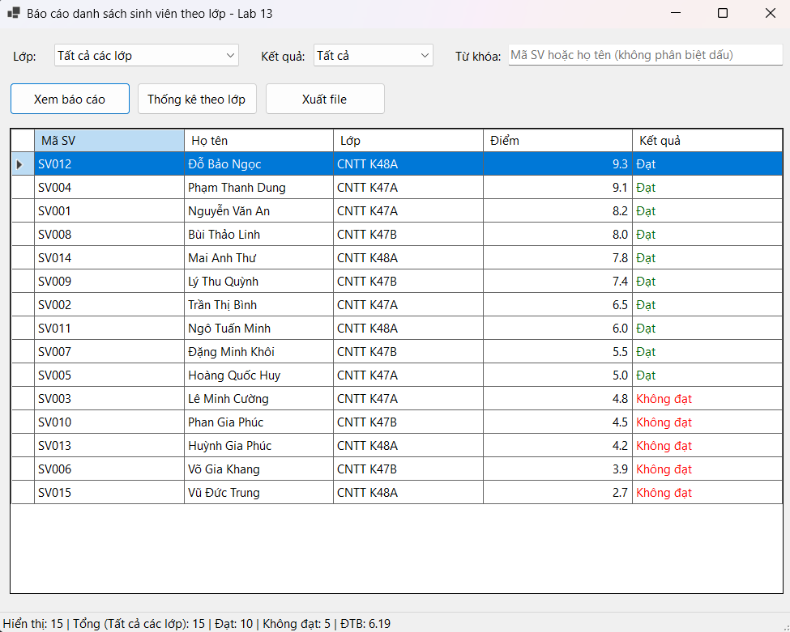
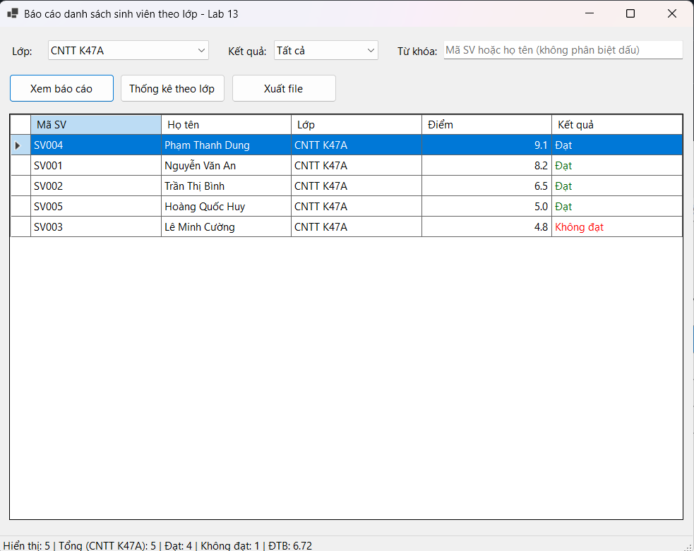
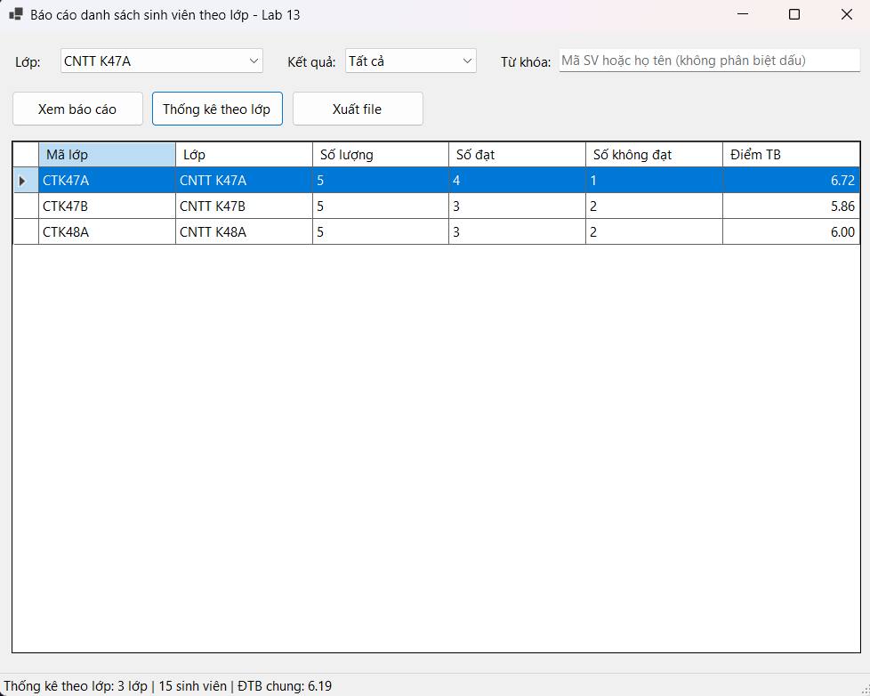
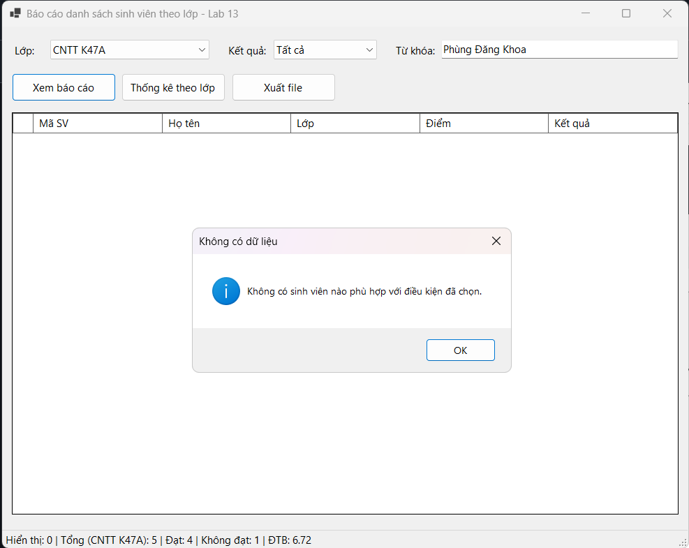
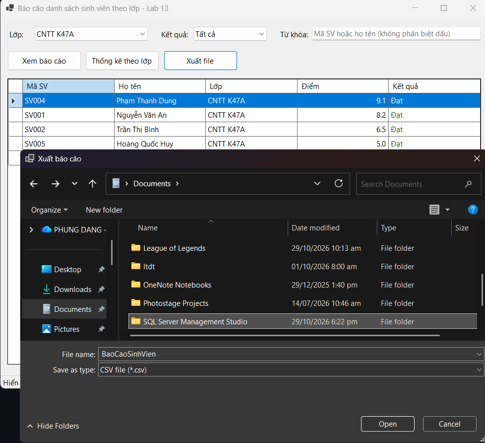

# BÁO CÁO THỰC HÀNH LAB 13: BÁO CÁO SINH VIÊN BẰNG LINQ

- **Học phần:** COMP1019 - Lập trình trên Windows
- **Giảng viên hướng dẫn:** ThS. Lê Thanh Thoại
- **Sinh viên thực hiện:** Phùng Đăng Khoa - 51.01.104.046
- **Môi trường phát triển:** Microsoft Visual Studio 2022 (C# WinForms, .NET 8)
- **Công nghệ:** LINQ, DataGridView, StatusStrip, SaveFileDialog
- **Dữ liệu:** Danh sách mẫu trong bộ nhớ (15 sinh viên, 3 lớp), không cần cơ sở dữ liệu

---

## 1. Cấu trúc Dự án (Project Organization)

```text
StudentReportDemo/
│
├── StudentReportDemo.sln              # Solution dự án Visual Studio
├── README.md                          # Tài liệu báo cáo kỹ thuật
│
├── images/                            # Ảnh chụp minh chứng thực nghiệm
│   ├── 1.png                          # Form khi mở: toàn bộ sinh viên, sắp xếp giảm dần theo điểm
│   ├── 2.png                          # Lọc theo lớp + kết quả "Đạt"
│   ├── 3.png                          # Lọc theo kết quả "Không đạt"
│   ├── 4.png                          # Tìm theo từ khóa (mã hoặc họ tên)
│   ├── 5.png                          # Thống kê theo lớp
│   ├── 6.png                          # Thông báo khi không có dữ liệu phù hợp
│   ├── 7.png                          # Hộp thoại lưu file CSV/TXT
│   └── 8.png                          # File báo cáo đã xuất (mở bằng Excel/Notepad)
│
├── exports/                           # File báo cáo CSV/TXT đã xuất từ chương trình
│
└── StudentReportDemo/
    ├── Program.cs                     # Điểm khởi chạy ứng dụng
    ├── Models/
    │   └── SinhVien.cs                # Model sinh viên, KetQua là thuộc tính chỉ đọc
    ├── Services/
    │   ├── BaoCaoExporter.cs          # Tạo nội dung và ghi file CSV/TXT
    │   └── TextHelper.cs              # Bỏ dấu tiếng Việt phục vụ tìm kiếm
    └── Forms/
        ├── FrmBaoCaoSinhVien.cs       # Xử lý sự kiện, LINQ lọc/sắp xếp/thống kê, xuất file
        └── FrmBaoCaoSinhVien.Designer.cs
```

---

## 2. Model & Dữ liệu mẫu

**`SinhVien`**: `MaSV`, `HoTen`, `MaLop`, `TenLop`, `Diem`, và `KetQua` (chỉ đọc, `"Đạt"` nếu `Diem >= 5`, ngược lại `"Không đạt"`).

`KetQua` được tính từ `Diem` nên không bao giờ bị lệch với điểm.

Dữ liệu mẫu gồm **15 sinh viên thuộc 3 lớp** (CTK47A, CTK47B, CTK48A), mỗi lớp 5 sinh viên, có cả trường hợp điểm sát ngưỡng (5.0) và nhiều mức điểm đạt/không đạt.

---

## 3. Các hàm chính và phần LINQ sử dụng

| Hàm | Nhiệm vụ | LINQ |
|---|---|---|
| `TaoDuLieuMau` | Tạo danh sách 15 sinh viên | Collection initializer |
| `LoadComboBox` | Nạp lớp vào `cboLop` (có mục "Tất cả các lớp"), nạp `cboKetQua` | `Select`, `Distinct`, `OrderBy`, `Prepend` |
| `XemBaoCao` | Lọc, sắp xếp, hiển thị lên `dgvBaoCao` | `Where`, `OrderByDescending`, `ThenBy`, `Select`, `ToList` |
| `LocDuLieu` | Lọc theo lớp, kết quả, từ khóa (không phân biệt hoa thường và dấu) | `Where` nối tiếp |
| `CapNhatThongKe` | Tổng số, số đạt, số không đạt, điểm trung bình trên `StatusStrip` | `Count`, `Average` |
| `btnThongKe_Click` | Thống kê số lượng, đạt, không đạt, điểm TB theo từng lớp | `GroupBy`, `Count`, `Average`, `OrderBy` |
| `XuatFile` | Lưu dữ liệu **đang hiển thị** ra CSV/TXT, có xử lý ngoại lệ | `Select`, `Where`, `ToList` |

### Xử lý các tình huống

- **Không có dữ liệu phù hợp:** hiện hộp thoại thông báo rõ ràng; khi xuất file mà lưới trống cũng cảnh báo.
- **Xuất CSV đúng chuẩn:** bao dấu `"` quanh ô chứa dấu phẩy/ngoặc kép, số luôn dùng dấu chấm thập phân (không phụ thuộc vùng), mã hóa UTF-8 có BOM để Excel hiển thị đúng tiếng Việt.
- **Ngoại lệ khi xuất file:** bắt riêng `UnauthorizedAccessException` (không có quyền ghi), `IOException` (file đang mở bằng Excel) và lỗi chung.
- **Giao diện:** chữ "Đạt" màu xanh, "Không đạt" màu đỏ; nhấn Enter trong ô từ khóa tương đương bấm *Xem báo cáo*.

---

## 4. Minh chứng Thực nghiệm và Kiểm thử Giao diện

### 4.1. Mở Form: hiển thị toàn bộ và sắp xếp giảm dần theo điểm



### 4.2. Lọc theo lớp và kết quả học tập

* **Lớp + kết quả "Đạt":**



* **Kết quả "Không đạt":**



### 4.3. Tìm kiếm theo từ khóa



### 4.4. Thống kê theo lớp



### 4.5. Thông báo khi không có dữ liệu phù hợp


### 4.6. Xuất báo cáo ra file CSV/TXT


File sau khi xuất (các file mẫu đặt trong thư mục `exports/`):


---

## 5. Hướng dẫn Cài đặt & Chạy Chương trình

1. Mở `StudentReportDemo.sln` bằng Visual Studio 2022 (cần workload *.NET desktop development*).
2. Nhấn `Ctrl + Shift + B` để build, nhấn `F5` để chạy. Không cần cài thêm thư viện hay cơ sở dữ liệu.

## 6. Kịch bản kiểm thử gợi ý

1. Mở Form: hiển thị 15 sinh viên, điểm cao nhất ở trên cùng.
2. Chọn lớp **CNTT K47A**, kết quả **Không đạt** → bấm *Xem báo cáo*: chỉ còn Lê Minh Cường (4.8).
3. Đặt từ khóa `nguyen` → vẫn tìm ra *Nguyễn Văn An* (không phân biệt dấu); từ khóa `zzz` → báo "Không có dữ liệu".
4. Bấm *Thống kê theo lớp*: mỗi lớp 5 sinh viên kèm số đạt, không đạt và điểm TB.
5. Bấm *Xuất file*, chọn CSV rồi mở bằng Excel/Notepad để kiểm tra. Nếu Excel hiển thị tất cả trong một cột, dùng *Data → From Text/CSV* và chọn dấu phân cách là dấu phẩy.
6. Thử ghi vào file đang mở bằng Excel: chương trình báo lỗi thân thiện, không bị treo.
